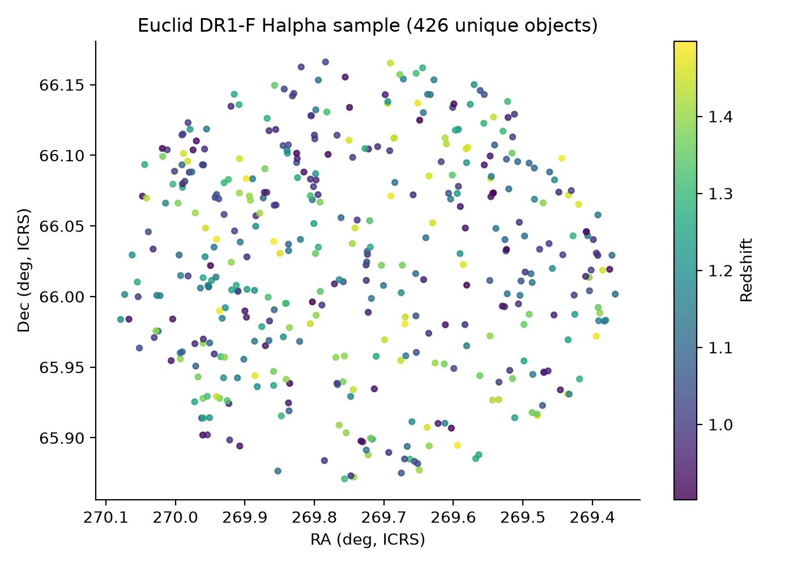
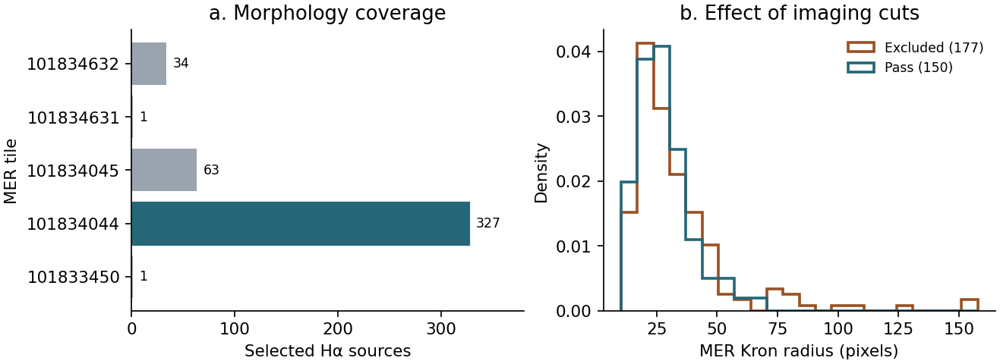
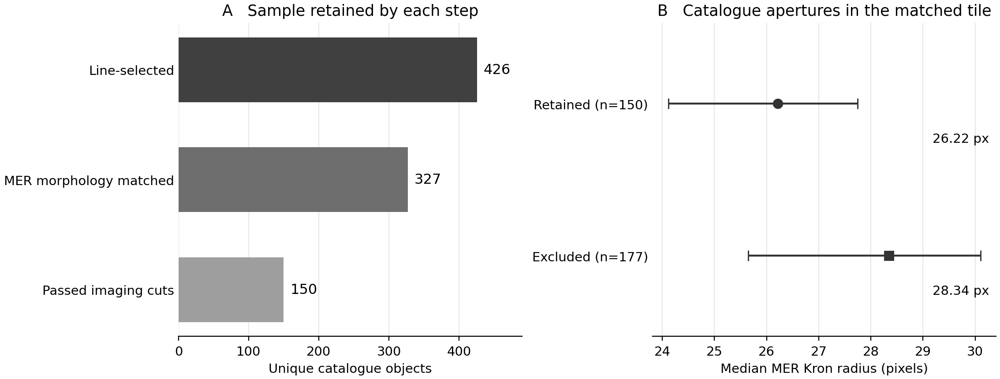
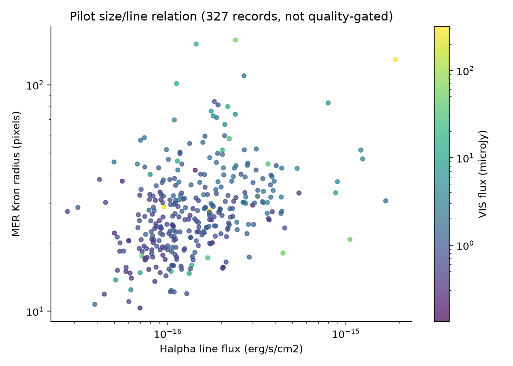
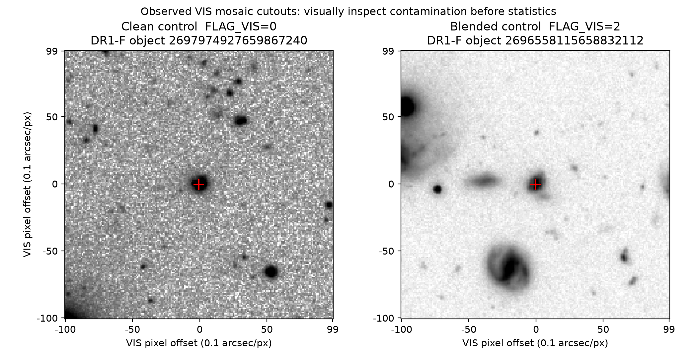
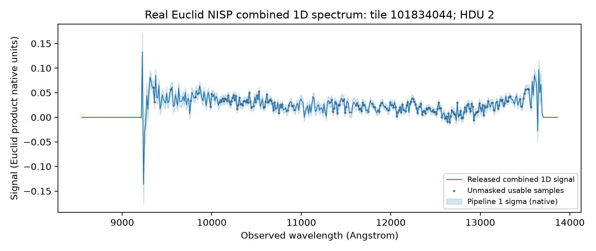

# Hα flux and photometric aperture radius in Euclid Deep Field North

Biswajit Jana · Day 1 · 14 November 2026

> This component is included in the [combined EDF North Hα study](../edf-north-halpha/).

[Original two-page report](report/Euclid_Day_1.pdf) · [LaTeX source](../manuscripts/day1.tex) · [Day 1 audit notebook](day01_audit.ipynb)

[](https://colab.research.google.com/github/Biswajit1999/daily-astro-notebooks/blob/master/euclid-dr1-foundation/2026-11-14-day01/day01_audit.ipynb)

## Abstract

This pilot asks whether galaxies with stronger detected Hα line flux have larger optical apertures at similar spectroscopic redshift and VIS brightness. In a 0.15° cone in Euclid Deep Field North, 426 selected objects yielded 327 matches to the released MER catalogue for tile `101834044`. The imaging cuts retained 150. The retained and excluded matches had median Kron radii of 26.22 and 28.34 pixels, respectively. Reapplying the redshift and brightness stratification to the retained sample left 61 objects in three eligible cells, below the study design’s minima of 200 objects and four cells. The difference between flag groups characterises this pilot’s selection. The full-field Hα–aperture association remains unresolved.

## 1. Introduction

Comparing Hα line flux with the angular extent of light in a broad optical band is a practical first check on Euclid measurements of emission-line galaxies. Both quantities depend on how the sources are detected and measured. Hα selection favours lines with sufficient signal in the available grism range. The MER Kron radius describes the semi-major axis of a detection-image aperture and depends on the light profile, neighbouring sources and the PSF. Related Euclid studies use fitted galaxy shapes or spatially resolved NISP line maps, which address different observables (Dunn et al. 2026, Gabarra et al. 2026). The question here is confined to catalogue aperture radius and detected Hα flux.

## 2. Observations and sample

The cone is centred at ICRS RA 269.733°, Dec +66.018°. The archived inputs contain 55,123 MER records, 7,553 rank-0 SPE candidates and 1,357,857 line-feature rows within the cone. Of 22,665 rank-0 Hα rows, 15,942 carry an invalid-flux sentinel. Requiring positive flux and error and S/N ≥5 returned 3,121 eligible rows for 1,522 distinct objects. After imposing the redshift range, 663 objects remained. The redshift-probability and VIS cuts retained 426.

| Sample step | Count |
|---|---:|
| Distinct objects with an eligible Hα fit | 1,522 |
| Catalogue redshift 0.90–1.50 | 663 |
| Redshift probability ≥0.99, VIS detected, positive VIS aperture flux | 426 |
| Positive Kron-radius measurement in the retrieved tile | 327 |
| Passed all imaging cuts | 150 |



*Figure 1. Sky positions of the 426 selected sources. Colour encodes the rank-0 SPE redshift.*

## 3. Methods

The HATS MER, SPE galaxy-candidate and SPE line tables were joined by exact object ID. For objects with more than one eligible Hα measurement, the object-level flux is the median of the eligible fits. Some fits share underlying exposures. The measurements were joined to the original MER FITS catalogue for tile `101834044`. The clean comparison requires a positive Kron radius, `FLAG_VIS=0`, `DET_QUALITY_FLAG=0` and `SPURIOUS_PROB<0.5`.

The statistic uses redshift bins [0.90, 1.10), [1.10, 1.30) and [1.30, 1.50), with VIS aperture-flux tertiles within each redshift bin. Each eligible cell has at least 20 sources and at least 10 in each half of the Hα flux split. The cell statistic is the high-minus-low difference in median log₁₀ Kron radius. The reported contrast averages cell statistics with weights proportional to their source counts. Labels were permuted within cells and the Hα halves were bootstrapped separately in the exploratory comparison. The original confirmatory design requires at least 200 clean sources and four eligible cells across the 1.25° field.

## 4. Results

### 4.1. Morphology coverage and quality cuts

Tile `101834044` accounts for 327 of the 426 selected objects. The other 99 lie in four tiles, chiefly `101834045` (63) and `101834632` (34). Their median VIS aperture flux is 1.062 µJy, compared with 0.967 µJy in the matched sample. They had no morphological measurement in the input used here.

Within the matched tile, 155 objects have nonzero VIS flags and 177 have nonzero detection-quality flags. These counts overlap. None has a spurious probability ≥0.5. Relative to the excluded group, the retained group has a 7.5% smaller median Kron aperture and 13.8% lower median Hα flux. The median redshifts are 1.142 and 1.145, respectively.

| Matched morphology group | N | Median Kron radius (pixels) | Median Hα flux (10⁻¹⁶ erg s⁻¹ cm⁻²) | Median VIS flux (µJy) |
|---|---:|---:|---:|---:|
| Passes all imaging cuts | 150 | 26.22 | 1.183 | 0.875 |
| Excluded by imaging cuts | 177 | 28.34 | 1.372 | 1.116 |



*Figure 2. The left panel counts selected objects by tile. The highlighted tile provided the original morphology measurements. The right panel compares the distributions of Kron radii for retained and excluded objects in that tile.*



The 19 November replay compared all 327 archived matches directly with the original 48,172-row MER FITS catalogue. The exact identifiers and five checked fields agreed: Kron radius, both imaging flags, spurious probability and VIS aperture flux. The median radius was 26.22 pixels (24.11–27.74) for the retained group and 28.34 pixels (25.65–30.10) for the excluded group. The parentheses give central 95% percentile intervals from 10,000 object bootstrap draws within each flag group. They describe the medians in this tile under object resampling; spatial dependence and catalogue systematics are outside these intervals. See [machine-readable results](analysis/real_results/day01_audit.json).

### 4.2. Flux and aperture contrasts

The 426 line-selected sources have a median redshift of 1.142 and a median Hα flux of 1.321 × 10⁻¹⁶ erg s⁻¹ cm⁻². The Hα flux and VIS aperture flux have Spearman ρ = 0.452 (95% bootstrap interval 0.362–0.536) in this selected sample. In the 327-object morphology match, the nine-cell Kron comparison yielded +0.04856 dex, equivalent to an 11.8% ratio between aperture-radius proxies. The original exploratory bootstrap interval was +0.00693 to +0.09182 dex. Reapplying the same cell rules after imaging selection leaves 61 objects across three eligible cells. The main study design requires at least 200 contributing objects and four cells. The pre-cut estimate describes the exploratory sample.



*Figure 3. Individual Hα and Kron-radius measurements for the 327-object morphology match before the final imaging cuts. Colour encodes the VIS aperture flux.*

### 4.3. Image and spectrum checks

The VIS examples have clean catalogue flags (`2697974927659867240`) and blending flags (`2696558115658832112`). The latter has nearby structure in its cutout. The Day 1 NISP spectrum (`2693349090658781626`) illustrates spectral masking for a different object. Of 433 bins spanning 8548.5–13862.1 Å, 194 pass the initial mask and 190 also satisfy `QUALITY>0.8`. No isolated interior peak exceeded 3σ in the adopted median-filter residual scan. The test is confined to that spectrum and its usable wavelengths.



*Figure 4. VIS examples of the catalogue flags. The cutouts illustrate nearby structure and why the imaging-quality cuts change the sample.*



*Figure 5. Day 1 spectrum used to illustrate wavelength coverage and masking. The Day 2 analysis matches spectra directly to the line-selected sample.*

## 5. Discussion and conclusions

The positive estimate describes the combined effects of detected Hα flux, the observed aperture and the pilot selection. Imaging cuts change the brightness and radius distributions, and the one-tile match excludes almost one quarter of the selected sources. Both effects can change a flux–aperture comparison. A measurement of an intrinsic size relation would require PSF-corrected sizes, a model of line detectability and a field large enough to assess spatial dependence. The eight-tile Day 2 analysis addresses the original morphology coverage and examines spectral quality directly. The 1.25° confirmatory field remains untested.

## Data and code availability

Run from this day’s directory with Python 3.11 or later. The notebook or commands below reproduce the audit from the small checked-in tables:

```bash
python -m pip install -r analysis/requirements.txt
python -m pytest -q analysis/tests
python analysis/scripts/audit_day01.py --output /tmp/euclid-day01-audit
```

Add `--mer-fits /path/to/mer_final.fits` to that final command to verify the join directly against the [original MER final catalogue for tile 101834044](https://nasa-irsa-euclid-dr1.s3.us-east-1.amazonaws.com/dr1/catalogs/MER_FINAL_CATALOG/101834044/EUC_MER_FINAL-CAT_TILE101834044-8358E0_20250829T054449.406866Z_00.00.fits) (92 MB). The FITS checksum is in the audit JSON. The catalogue uses pixels for the Kron radius and µJy for the VIS aperture flux.

To rebuild from the released catalogues, install `lsdb`, `s3fs` and `boto3` in the same environment, then run:

```bash
python analysis/scripts/run_day01_hats_pilot.py
python analysis/scripts/fetch_real_vis_nisp.py
python analysis/scripts/reproduce_real_day01_pilot.py analysis/pilot_real analysis/real_media /tmp/euclid-day01-replay
```

The first script fetches the small-field HATS extracts. The second downloads the original morphology and example image/spectrum products. `extract_vis_comparison.py` regenerates the two VIS stamps directly from the original mosaic using byte ranges and its FITS WCS. The archived `pilot_source_counts.json` preserves the first fetch and its legacy status. Its initial join discarded every repeated rank-0 Hα ID; both current catalogue scripts now combine the valid fits per object before joining. The [original report and design conditions](../manuscripts/day1.tex) describe the separate 1.25° test.

## Acknowledgements

This work has made use of the Data Release (DR1) data from the Euclid mission of the European Space Agency (ESA). Data are distributed through NASA/IPAC IRSA.

## References

- Aussel, H., et al. (Euclid Collaboration) 2026, *Euclid First Data Release 1 (DR1). Data release overview*. [arXiv:2611.16510](https://arxiv.org/abs/2611.16510).
- Dunn, M., et al. (Euclid Collaboration) 2026, *Bayesian 3D shape inference of star-forming galaxy populations*. [arXiv:2611.16109](https://arxiv.org/abs/2611.16109).
- Gabarra, L., et al. (Euclid Collaboration) 2026, *First NISP emission-line maps*. [arXiv:2611.16504](https://arxiv.org/abs/2611.16504).
- Euclid Collaboration and IRSA 2026, DR1-Foundation [MER Deep](https://doi.org/10.26131/IRSA675), [SPE galaxy candidates](https://doi.org/10.26131/IRSA696), [SPE lines](https://doi.org/10.26131/IRSA692) and [SIR spectra](https://doi.org/10.26131/IRSA680).
