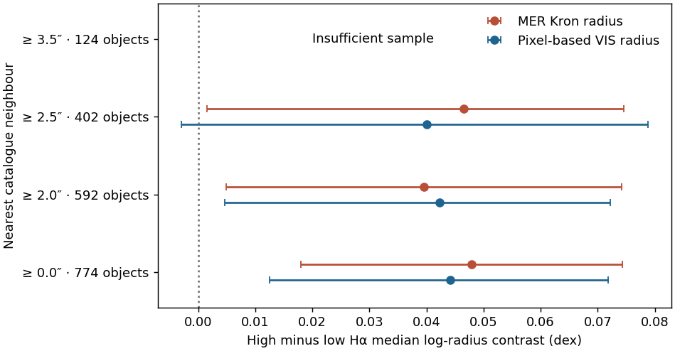
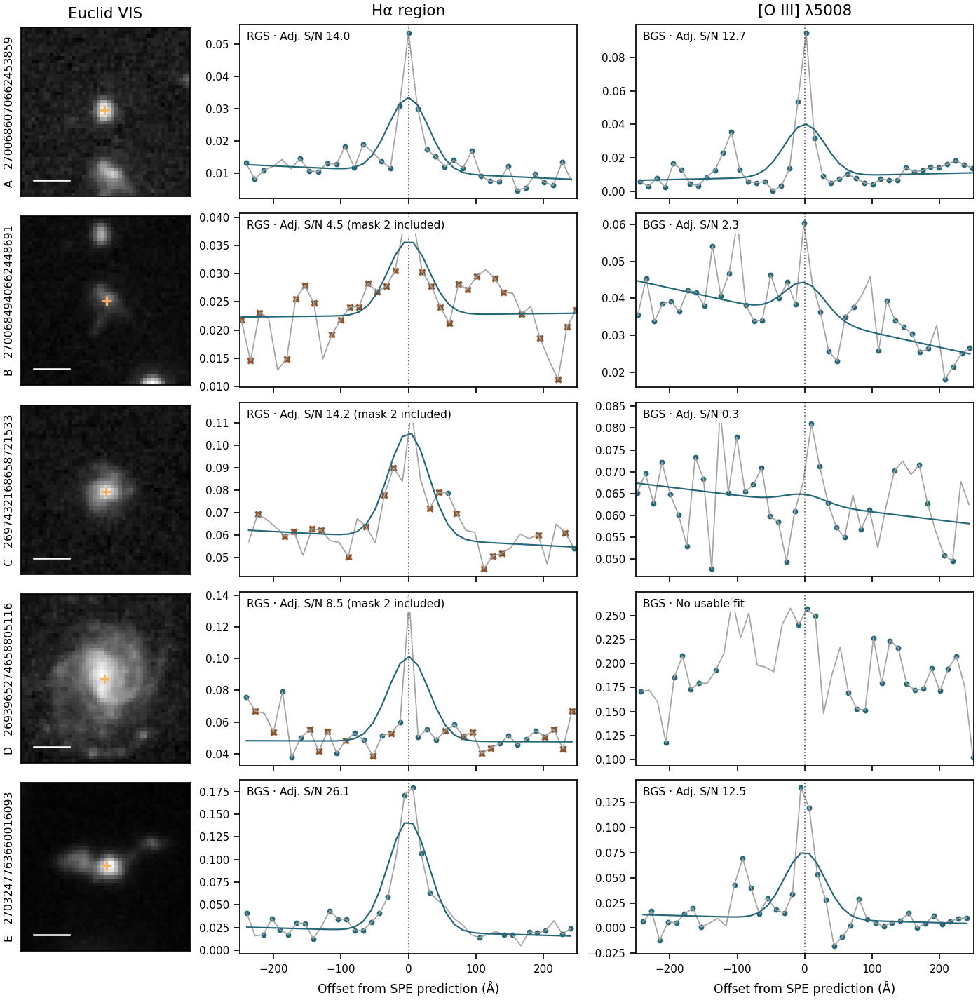
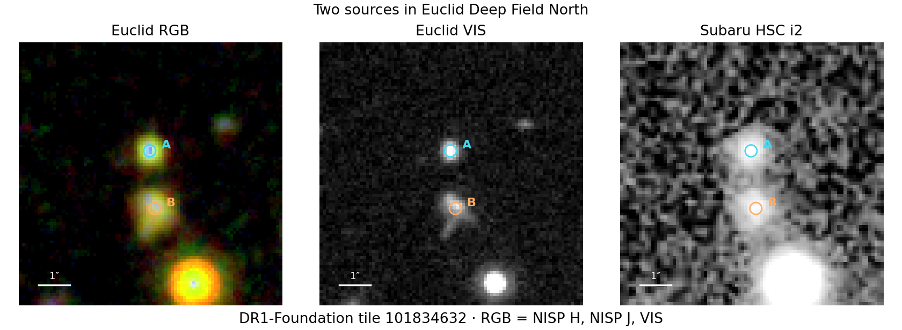

# Aperture-size sensitivity and five spectral case studies in Euclid Deep Field North

Biswajit Jana · Day 2 · 15 November 2026

> This component is included in the [combined EDF North Hα study](../edf-north-halpha/).

[Download the two-page A&A-format report](report/Euclid_Day_2.pdf) · [LaTeX source](../manuscripts/day2.tex)

## Abstract

**Context.** Aperture measurements and slitless spectra respond to source blending, data masks and spatially varying observing conditions.

**Aims.** Test the sensitivity of the Day 1 Hα–aperture result to tile coverage and measurement choices. Compare the evidence for five sources selected to illustrate different image and spectrum outcomes.

**Methods.** A 0.28° cone was matched to eight original MER tile catalogues. Hα flux and size contrasts were recomputed with different line measurements, direct VIS apertures and whole-tile resampling. Combined and individual NISP spectra were checked with fixed-centre line templates. Q1 and DESI supplied comparison measurements where available.

**Results.** All 1,576 selected sources had morphology matches, and 782 passed the imaging cuts. The Kron contrast was +0.05166 dex. The direct VIS contrast using reliable red-grism Hα fluxes was +0.0140 dex, with whole-tile 95% bootstrap percentiles of −0.0173 to +0.0443 dex. Of the five examples, one has a repeatable Hα-region signal, one is dominated by a flagged bin, and one agrees with an independent DESI redshift. The other two are 1.868″ apart and have unequal spectral evidence.

**Conclusions.** The more restrictive size comparison leaves the association unresolved. Exposure repeatability and independent redshifts give stronger checks on individual line identifications than a high combined-spectrum S/N alone.

## 1. Introduction

The Day 1 pilot matched only one of the five tiles containing selected galaxies. Day 2 restores morphology coverage for all tiles in a larger pilot and tests how the result changes when the line flux, the size estimator and the spatial grouping change. The same data also allow an object-by-object check of whether candidate line features persist after masking and across independent dispersion directions. Red-grism Hα-region fits can include unresolved [N II]. Other sources can contaminate slitless extractions when their traces overlap (Fumana et al. 2026, Gabarra et al. 2026).

## 2. Observations and sample

The 0.28° cone is centred at ICRS RA 269.733°, Dec +66.018°. It contains 194,011 HATS MER source records and 26,611 rank-0 SPE candidates. Of 79,860 rank-0 Hα rows, 10,908 valid positive fits with S/N ≥5 correspond to 5,280 objects. Requiring 0.90–1.50 catalogue redshift, redshift probability ≥0.99, a VIS detection and positive VIS aperture flux leaves 1,576 objects across eight tiles. All 1,576 were matched by exact ID to the original MER FITS catalogues. The same quality cuts as Day 1 leave 782 sources.

The spectral screen uses 858 objects with both grism spectra in the three sampled HATS partitions. Of these, 421 pass the imaging cuts. The five examples below illustrate different checks rather than a statistical sample. A and B occupy the same small region of tile `101834632`. C and D have individual red-grism extractions in tile `101834044`. E is a DESI comparison source in tile `101834045`.

## 3. Methods

**Catalogue radii.** The primary statistic is the object-count-weighted high-minus-low Hα difference in median log₁₀ Kron radius, in redshift bins and VIS aperture-flux tertiles. The baseline line estimate takes the median of eligible Hα fits per source. Separate runs prefer reliable combined fits or use red-grism fits alone (SPE Gaussian-fit quality code 212).

**Direct VIS radii.** The direct measurement is the circular radius enclosing half the background-subtracted flux within 1.5″ of the MER position. The background is the median in a 2.5–3.5″ annulus. Pixels with the VIS `INVALID` bit are excluded. The analysis requires usable coverage of at least 98% within 2″ and 80% in the background annulus. It repeats the aperture measurement with outer radii of 1.0″ and 2.0″. For the spatial check, cells are defined within each tile, redshift bin and VIS-brightness half, with at least five objects in each Hα half. A 4,000-draw bootstrap resamples tile effects.

**Spectrum checks.** The fit uses a local linear continuum and a 30 Å Gaussian template centred at the wavelength predicted from the SPE redshift. The window extends ±250 Å, using a ±45 Å core and continuum sidebands 125–250 Å from the centre. Strict fits require mask 0, quality above 0.8, positive variance, at least one contributing exposure, at least five usable samples on each sideband and valid sampling on both sides of the core. The alternate mask admits pixels carrying only the low-S/N warning (mask 2). The adjusted S/N divides formal S/N by the larger of one and the sideband residual RMS in noise units. These are fixed-redshift diagnostics. They omit wavelength covariance and a blind-search trials correction.

## 4. Results

### 4.1. The size comparison depends on the measurement and resampling unit

| Radius and Hα flux | Objects | Contrast (dex) | 95% bootstrap interval or percentiles (dex) |
|---|---:|---:|---:|
| MER Kron radius, object-level median Hα | 782 | +0.05166 | +0.0204 to +0.0761 |
| MER Kron radius, reliable red Hα | 700 | +0.05348 | +0.0155 to +0.0759 |
| Direct VIS radius, median Hα, ≥2.0″ isolation | 398 | +0.03363 | −0.0116 to +0.0710 |
| Direct VIS radius, reliable red Hα, ≥2.0″ isolation | 398 | +0.01402 | −0.0173 to +0.0443 |
| Direct VIS radius, reliable red Hα, ≥2.5″ isolation | 233 | +0.01719 | −0.0211 to +0.0624 |

The first two rows resample objects within cells. The last three resample whole tiles, with five tiles contributing eligible cells at the 2.0″ cut. The two 398-object rows use the same galaxies, so the 0.01961 dex reduction in the contrast isolates the change in the Hα estimate for this comparison. In linear units, the reliable-red result corresponds to a +3.3% aperture-radius ratio difference, with descriptive endpoints of −3.9% and +10.7%. At 2.0″ the reliable-red contrast is positive in three tiles and negative in two. The matched comparison and the breadth of the bootstrap distributions matter more for interpretation than the narrower interval from the original object bootstrap.

*Figure 1. Sensitivity to neighbour distance before whole-tile resampling. The plotted intervals come from the object bootstrap. The spatial results are given separately in the table.*

### 4.2. Five sources and five evidential outcomes

| Source | Euclid DR1 MER ID | ICRS RA, Dec (degrees) | SPE z | Observation and outcome |
|---|---|---|---:|---|
| A | `2700686070662453859` | 270.068607, +66.245386 | 1.37204 | Strict adjusted S/N is 14.02 for the red Hα region and 12.69 for blue [O III] λ5008. Both features support the catalogue wavelength solution. |
| B | `2700684940662448691` | 270.068494, +66.244869 | 1.18115 | Visible extension in VIS. All six spectral core bins near Hα carry the low-S/N warning. The relaxed adjusted S/N is 4.50. The strict [O III] S/N is 2.28. The redshift remains tentative. |
| C | `2697432168658721533` | 269.743217, +65.872153 | 1.39996 | Hα-region flux is positive in all 12 usable strict individual red extractions. Formal S/N peaks at 7.98 and 6.93 in separate directions for fits with no listed contaminant. [O III] is weak (adjusted S/N 0.35). |
| D | `2693965274658805116` | 269.396527, +65.880512 | 1.10655 | Warning-inclusive combined formal S/N is 21.23. Removing the brightest flagged bin lowers it to 1.14. The largest strict individual-exposure S/N is 2.34. |
| E | `2703247763660016093` | 270.324776, +66.001609 | 0.97575 | Blue Hα and [O III] have strict adjusted S/N of 26.11 and 12.46. DESI z = 0.975547 at an offset of 0.102″. VIS and detection flags are 2 and 258. |

*Figure 2. Each row shows one 4.7″ VIS stamp and two NISP windows. The white bar is 1″. Flux density is in 10⁻¹⁶ erg s⁻¹ cm⁻² Å⁻¹. Zero wavelength offset is set by the catalogue redshift. Crosses mark bins admitted only by the mask-2 test. The relaxed combined fits for C and D must be read with the individual-exposure results in the table.*

#### A and B in earlier observations

A and B have distinct Euclid Q1 positions within 0.008″ and 0.019″ of their DR1 positions. Both are visible in Subaru HSC i2. Subaru’s resolution leaves the shape of B’s faint extension uncertain. The MER Kron radii are 14.07 pixels for A and 24.43 pixels for B. The catalogue ellipticities are 0.183 and 0.166, respectively. The VIS invalid-pixel bit is absent within 1″ of either centre. This check does not resolve the extension’s origin. Searches by both releases’ IDs and coordinates found no paper dedicated to either source and no secure SIMBAD or NED identification. A CADC footprint search returned no HST/JWST rows for the tested collections. MAST timed out, leaving the exact space-based coverage unresolved.

*Figure 3. Registered Euclid NISP H/J plus VIS RGB, Euclid VIS, and Subaru HSC i2. The circle markers give the two catalogue positions. The pair is separated by 1.868″ on the sky.*

At the catalogue redshifts, the Planck18 lookback times would be 9.18 Gyr for A and 8.60 Gyr for B, with scales of 8.64 and 8.50 proper kpc arcsec⁻¹, respectively (Planck Collaboration 2020). These distance estimates are conditional on the line assignments. The data leave a physical association, origin and chemical composition unresolved.

#### Repeatability and external checks

For C, the fitted Hα-region signal recurs in both red-grism orientations. Removing the largest combined-spectrum bin leaves too few usable core samples for the original fit. The repeated-exposure result is therefore the stronger evidence. For D, the bright bin has mask 2 and the individual fits show little support. The fair comparison is between C and D’s repeatability, since both have high warning-inclusive combined scores. E’s independent DESI spectrum supports the Euclid redshift even though the Euclid imaging flags indicate that its morphology warrants separate treatment. In the broader pilot, 81 of 97 unique Euclid–DESI matches within 0.2″ agree at |Δz|/(1+z_DESI) ≤0.002. That fraction describes the matched subset.

## 5. Discussion and conclusions

The size contrast is positive for the catalogue-based comparisons and smaller when using direct VIS radii, reliable red-grism fluxes and spatial grouping. The available tile bootstrap includes zero. The field is small, adjacent tiles may share systematics, and Hα selection conditions the sample on detectable emission. These factors limit inference about intrinsic galaxy size. The 1.25° predeclared region and a selection-function model remain the most direct extensions of the population analysis.

The examples separate three questions that require different evidence. A and E have spectral features consistent with their catalogue redshifts, and E has external confirmation. C and D show why repeat extractions matter when the combined line is mask-sensitive. B’s shape is an imaging question best tested against an exposure-level PSF and the brighter neighbour. Independent VIS stacks and 2D contamination traces would test those specific ambiguities.

## Data and code availability

`analysis/` holds the measurements, Python scripts and archive extracts. From this day’s directory run `python analysis/scripts/plot_five_sources.py` to generate Figure 2 and its fit table, or `python analysis/scripts/audit_edfn_pair.py` for the RGB, pair spectra and Q1 matches. These two scripts use the archived local extracts. The multi-tile workflow starts with `analysis/scripts/run_multitile.py` and retrieves the full input catalogues from IRSA.

## Acknowledgements

This work has made use of the Data Release (DR1) data from the Euclid mission of the European Space Agency (ESA). NASA/IPAC IRSA distributes the Euclid data and the Subaru HSC WISHES i2 mosaic used here. DESI DR1 spectra were queried through NOIRLab Astro Data Lab.

## References

- Aussel, H., et al. (Euclid Collaboration) 2026, *Euclid First Data Release 1 (DR1). Data release overview*. [arXiv:2611.16510](https://arxiv.org/abs/2611.16510).
- Fumana, M., et al. (Euclid Collaboration) 2026, *SIR spectroscopic calibration*. [arXiv:2611.17305](https://arxiv.org/abs/2611.17305).
- Gabarra, L., et al. (Euclid Collaboration) 2026, *First NISP emission-line maps*. [arXiv:2611.16504](https://arxiv.org/abs/2611.16504).
- Planck Collaboration 2020, *Planck 2018 results. VI. Cosmological parameters*, A&A, 641, A6. [DOI](https://doi.org/10.1051/0004-6361/201833910).
- Euclid Collaboration and IRSA 2025–2026, [Q1 MER](https://doi.org/10.26131/IRSA602), DR1-Foundation [MER Deep](https://doi.org/10.26131/IRSA675), [SPE galaxy candidates](https://doi.org/10.26131/IRSA696), [SPE lines](https://doi.org/10.26131/IRSA692) and [SIR spectra](https://doi.org/10.26131/IRSA680).
- DESI Collaboration, [Data Release 1](https://data.desi.lbl.gov/doc/releases/dr1/).
