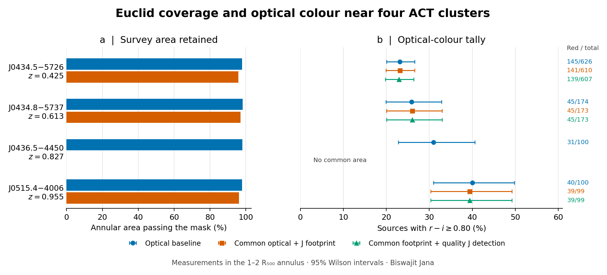

# Does the shared Euclid footprint change an optical-colour count near ACT clusters?

**Biswajit Jana · 19 November 2026**

A visible-to-infrared catalogue requires the same patch of sky in both bands. This follow-up asks whether that requirement changes a fixed *optical* colour tally measured in the $1$–$2\,R_{500}$ annulus of four ACT clusters. Holding the optical classification fixed lets the area cut be tested independently of the infrared flux criterion.

[](results/colour_coverage.pdf)

*Figure 1.* Blue shows the optical baseline. Orange adds the Euclid NISP $J$ coverage requirement, and green also requires a measured $J$-band signal-to-noise ratio of at least five and a clean $J$ flag. The area calculation uses the released single-band coverage maps. Points show the fraction of selected optical sources with DECam $r-i\geq0.80$ AB magnitudes. Bars are descriptive 95% Wilson intervals for each count. The samples are nested. Uncertainty on the **change** was calculated separately using paired angular sectors. A field with zero common area has an undefined fraction for the two infrared selections.

## Results

| ACT field | Optical area | With shared $J$ area | Optical red / all | Common-footprint red / all | Change (percentage points) |
|---|---:|---:|---:|---:|---:|
| J0434.5−5726 | 97.9% | 95.8% | 145 / 626 | 141 / 610 | −0.05 |
| J0434.8−5737 | 98.3% | 97.1% | 45 / 174 | 45 / 173 | +0.15 |
| J0436.5−4450 | 98.0% | 0.0% | 31 / 100 | — | — |
| J0515.4−4006 | 98.0% | 96.2% | 40 / 100 | 39 / 99 | −0.61 |

The common footprint removed **one of the four sightlines entirely**, including all 100 optical sources that met the baseline cuts in that field. In the three fields that remained, the optical-colour fraction changed by **−0.61 to +0.15 percentage points**. The paired sector ranges included zero for all three fields at the baseline mask cut. Of the 882 sources retained under the common footprint, 879 also passed the $J$-band photometric quality cut.

At a stricter per-band mask threshold of 0.95, J0515.4−4006 shifted by **−2.18 percentage points** with a 95% paired sector bootstrap range of **−5.11 to +0.89**. The full [results](results/colour_results.json) also include a brighter $i$ limit and optical colour cuts of 0.65 and 0.95 magnitudes. The missing J0436.5−4450 sightline stays missing under all four alternatives.

## Sample and measurement

1. Use the four wide catalogue fields from the [ACT–Euclid coverage pilot](../act-cluster-coverage/). The ACT positions and published `theta500Arcmin` define the $1$–$2\,R_{500}$ annulus. Require the entire sampled annulus to be represented by the released single-band mask file for the cluster's tile. The four sightlines occupy three Euclid tiles.
2. Select MER catalogue optical detections with `VIS_DET=1`, zero detection-quality and spurious flags, and exclude objects flagged as point-like. Require unflagged, finite VIS, $r$, and $i$ photometry with S/N ≥ 5 in the PSF-matched 2-FWHM-diameter apertures. Use DECam $i\leq23$ AB, and label a source red when its observed DECam $r-i\geq0.80$. These are apparent-colour and flux cuts applied consistently to the two selections.
3. Require the local VIS, DECam $r$, and DECam $i$ mask weights to be at least 0.80. For the shared footprint also require the local $J$ weight to be at least 0.80. The optional $J$ detection step applies the same flag and S/N cuts to the MER $J$ flux.
4. Estimate the fraction of annular area satisfying each mask with 32,768 equal-solid-angle Sobol points. Apply the same published masks to the actual source positions. Estimate the change in the colour fraction by resampling the eight paired 45° position-angle sectors with replacement. The sector intervals describe sensitivity to azimuthal sampling within a single field. With eight sectors and sparse removals, they are coarse and can have an endpoint of zero.

## What this test supports

The measurements count projected sources around known clusters. Foreground and background galaxies can enter the sample. The same observed colour at different redshifts can represent different rest-frame colours. Consequently these measurements do not establish a red-member fraction, a quenching gradient, or a release-wide loss rate. The comparison demonstrates a whole-sightline loss and quantifies the much smaller change in the colour tally in the three sightlines that can still be measured. To extend this to cluster galaxies, select members using spectroscopy or redshifts obtained independently of the $J$ cut and compare red-fraction profiles under both masks.

## Reproduce

Run from this directory with Python 3.11 or later.

```bash
python -m pip install -r requirements.txt
python measure_colour.py
```

The script downloads the [three MER catalogues and twelve released masks](inputs.json), about 603 MB in total, if they are absent. It records each input's SHA-256 digest in [the result file](results/colour_results.json) and saves a [vector PDF](results/colour_coverage.pdf) and a [PNG](results/colour_coverage.png). The analysis uses the fixed sample and spherical annulus sampler in the preceding coverage study.

## Data credits and references

This work has made use of the Data Release (DR1) data from the Euclid mission of the European Space Agency (ESA). Thanks to the Euclid Consortium, NASA/IPAC IRSA, the ACT/DES/HSC collaborations, NASA LAMBDA, and the teams that provided the DECam imaging.

- Euclid Collaboration, Aussel et al. (2026), [DR1 overview](https://pubs.euclid-ec.org/public/dr1/aussel.pdf), and [IRSA MER Wide Survey catalogue](https://doi.org/10.26131/IRSA673).
- Euclid Collaboration (2026), [The MERge processing](https://arxiv.org/abs/2611.17832). This describes the released source selection and PSF-matched photometry.
- Euclid Collaboration, Odier et al. (2026), [Euclid DR1 photometric masks](https://arxiv.org/abs/2611.16602), and [ESA's data product description for the HEALPix band-coverage mask](https://euclid.esac.esa.int/dr/dr1/dpdd/le3dpd/id/vmpz-id/dpcards/vmpzid_healpix_coverage.html).
- ACT/DES/HSC Collaboration, [ACT DR6 cluster catalogue v1.0](https://lambda.gsfc.nasa.gov/product/act/actadv_dr6_szcluster_catalog_info.html) and [catalogue paper](https://arxiv.org/abs/2507.21459).
