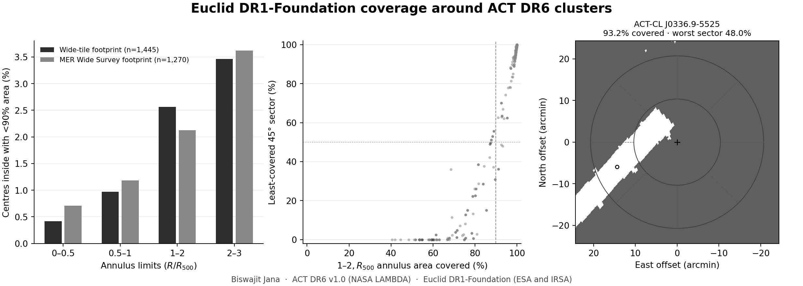

# How much of a cluster's outskirts did Euclid cover?

**Biswajit Jana · 19 November 2026**

A cluster can be inside an imaging footprint while part of the annulus used for a radial profile falls outside it. Using the public Euclid DR1-Foundation release and the ACT DR6 cluster catalogue, I measured how often that happens and whether an area cut also protects individual position-angle sectors.



The right-hand panel shows the MER footprint in grey. White is outside the footprint, the circles mark R500 and 2 R500, and the open marker identifies the least-covered sector.

## Results

I evaluated all **10,040** entries in the ACT DR6 v1.0 FITS catalogue. The two public maps answer different questions. One covers the DR1 Wide image tiles. The other covers the MER Wide Survey catalogue. Of the **1,445** ACT centres inside the tile map, **1,270** were also inside the catalogue map, leaving **175** tile-only centres.

| Map and count | Wide tiles | MER Wide Survey catalogue |
|---|---:|---:|
| Centres inside | 1,445 | 1,270 |
| Less than 90% covered in the 0–0.5 R500 region | 6 | 9 |
| Less than 90% covered in the 0.5–1 R500 annulus | 14 | 15 |
| Less than 90% covered in the 1–2 R500 annulus | 37 (2.56%) | 27 (2.13%) |
| At least one sector below 90% in the 1–2 R500 annulus | 42 | 49 (3.86%) |
| Less than 90% covered in the 2–3 R500 annulus | 50 | 46 |
| ACT Legacy subset below 90% in the 1–2 R500 annulus | 16 / 585 | 11 / 517 |

In the MER map, two clusters reach 90% total area in the 1–2 R500 annulus while the least-covered 45° sector is below 50%. **ACT-CL J0336.9−5525** has **93.21%** total area and **47.97%** in its least-covered sector. **ACT-CL J0432.6−5915** has **92.49%** and **48.63%**, respectively.

The catalogue's angular-radius uncertainties change the 90% classification for **5 of 1,270** MER-selected clusters when comparing the published radius minus and plus one standard error. Moving the annulus from the SZ centre to the listed optical centre changes the classification for **4 of 1,198** with valid optical coordinates. Increasing the sampling density changes the area fraction by at most **0.22 percentage points** for centre-selected MER annuli. These are sensitivity checks for this catalogue, whose entries are counted directly. They are not estimates of population variance.

### Check against effective photometric coverage

I also evaluated two small, fixed lists of public Euclid CL effective-mask files. Eight ACT clusters had centres and complete sampled 1–2 R500 annuli represented by a single selected file. Four of them lay entirely inside both geometric maps. Their effective weights averaged **90.1%, 92.5%, 0.0% and 90.6%**, respectively. The zero-weight case is **ACT-CL J0436.5−4450** in tile **102024504**, where all 32,768 samples mapped to HEALPix cells explicitly present in the file. Its released CL map gives zero weight over this annulus. The other three had at least one sector below 90% effective coverage.

A check of that tile's single-band maps gives **98.44% mean VIS coverage** and positive VIS weight at all sampled positions, while **NISP Y and J both have zero coverage** over the same annulus. The four released DECam band maps examined have full coverage there. The aggregate geometry alone would admit this field to either a VIS or a multiband sample. The released band maps show why the two selections need different masks. The cause of the NISP coverage gap was not investigated.

These eight cases come from a convenience sample determined by file order and single-tile containment. They show how geometric and effective coverage can diverge and provide no survey-wide rate. The CL weights combine information from Euclid and external bands and include masking for contaminants. The per-target measurements and exact FITS files are listed in [the pilot results](results/effective_pilot.json) and [the input list](results/effective_inputs.json). The single-band inputs and checks are in the pilot results.

## Method

1. Use the ACT SZ positions, catalogue redshifts, and published angular radius `theta500Arcmin`. Here R500 is the ACT catalogue's scale corresponding to a mean enclosed density of 500 times the critical density. The ACT Legacy subset uses the release's fixed-S/N, flag, and optical-footprint cuts.
2. Integrate each annulus over solid angle using a scrambled Sobol sequence. Draw 4,096 points per annulus, and refine partially covered cases to 32,768 points with a second scramble. Count coverage by eight 45° sectors measured east of north. The script evaluates membership in the unmodified order-13 maps.
3. For the effective mask comparison, take the first 64 CL FITS files by bucket key in each of the `EffCovOnly` and `MosaicMasks` processing families. Require the centre and all sampled annular positions to land in explicitly listed Nside 16,384 cells from a single file. Average the tabulated weights over the same annulus and report the least-covered sector.
4. Repeat the outskirts calculation at the ACT angular radius plus and minus its quoted uncertainty and, separately, using the ACT catalogue optical position when available. Great-circle positions were checked against Astropy and the integration returned the expected values for fully covered and fully uncovered controls.

The geometric maps describe archive footprint. The effective masks estimate usable photometric area under their own selection, and the pilot tests that selection for particular tiles. A future shear or member-galaxy analysis will also need its own source selection and a random catalogue subject to the same cuts. The study measures coverage and contains no shear or mass fit. The ACT radius and redshift are published inputs.

## Reproduce

Run from this directory with Python 3.11 or later.

```bash
python -m pip install -r requirements.txt
OPENBLAS_NUM_THREADS=1 python analyze.py
OPENBLAS_NUM_THREADS=1 python effective_pilot.py
```

The first command-line analysis downloads the three public inputs (about 27 MB) as needed and writes a [summary](results/summary.json), a [compressed CSV](results/clusters.csv.gz), and the figure. The CSV retains all ACT entries with sampled coverage in either map up to 3 R500, or with a centre inside either map. Column names identify the mask, annulus and quantity. The `outskirts_quad` column is the modulus of the second angular Fourier moment of the eight geometric coverage fractions, normalised by their sum. The sensitivity columns contain fractions recomputed with a perturbed radius or centre.

The optional effective-mask replay uses the URLs and SHA-256 values in the committed input list. Raw FITS files remain with their public archives. Both scripts accept `--data` and `--out`.

## Data credits and references

This work has made use of the Data Release (DR1) data from the Euclid mission of the European Space Agency (ESA). Thanks to the Euclid Consortium and NASA/IPAC IRSA for the public release and coverage maps, and to the ACT, DES and HSC collaborations and NASA LAMBDA for the public cluster catalogue.

- Euclid Collaboration, Aussel et al. (2026), [Euclid First Data Release 1 — Data release overview](https://pubs.euclid-ec.org/public/dr1/aussel.pdf).
- NASA/IPAC IRSA, [Euclid DR1 data products and the two footprint definitions](https://irsa.ipac.caltech.edu/euclid-archive-documentation/data-products/#moc). The associated MER Wide Survey catalogue has [DOI 10.26131/IRSA673](https://doi.org/10.26131/IRSA673).
- Euclid Collaboration, Odier et al. (2026), [Euclid DR1 photometric masks](https://arxiv.org/abs/2611.16602), and ESA's [effective-mask data description](https://euclid.esac.esa.int/dr/dr1/dpdd/le3dpd/id/vmpz-id/dpcards/vmpzid_healpix_effectivecoverage.html).
- Aguena et al. (ACT/DES/HSC Collaboration), [ACT DR6 SZ-selected cluster catalogue paper](https://arxiv.org/abs/2507.21459). Counts and radii here use the [final v1.0 catalogue at NASA LAMBDA](https://lambda.gsfc.nasa.gov/product/act/actadv_dr6_szcluster_catalog_info.html), with the [v1.0 column and Legacy-cut definitions](https://extragalactic.phys.wits.ac.za/act-dr6-clusters/v1.0/).
- Euclid Collaboration (2026), [Survey mask effects on clustering of galaxy clusters](https://arxiv.org/abs/2611.06304). That work tests the two-point correlation function in mock lightcones. The present measurement uses the released masks to evaluate radial and angular coverage around individual observed ACT clusters.
