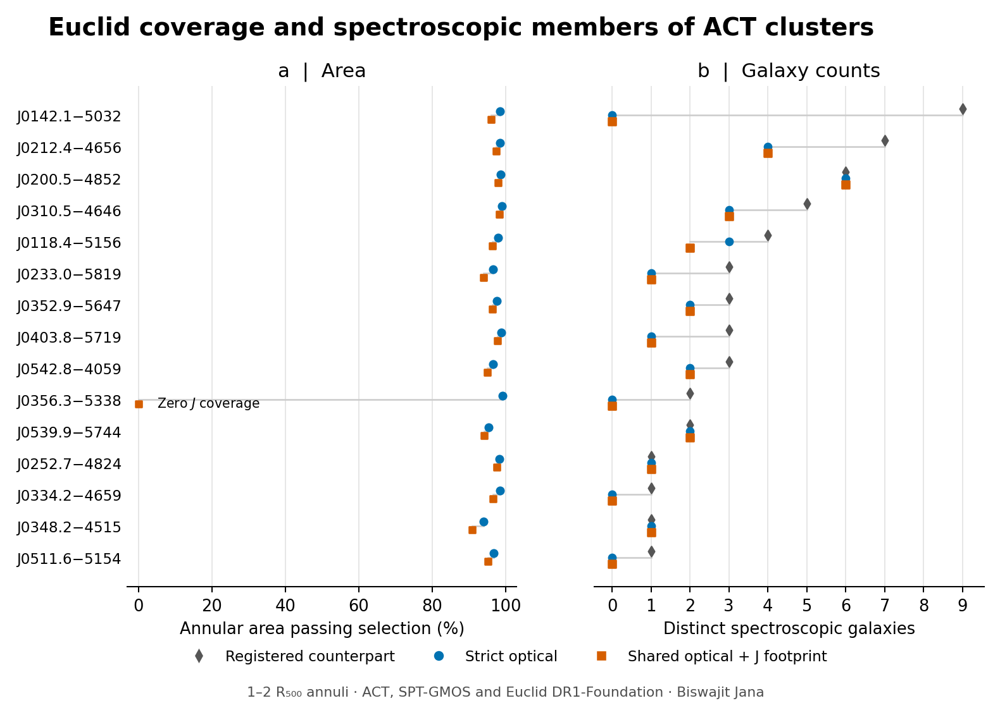

# Spectroscopic sample extension to 15 ACT cluster fields

**Biswajit Jana · 20 November 2026**

I extended the [three-field spectroscopic cross-match](README.md) to every remaining ACT field in that screen with an SPT-GMOS spectrum in $1\le R/R_{500}<2$ and $|\Delta v|\leq2500$ km/s. This added 12 fields and 29 spectra. The original four photometric pilot fields are a separate sample.



*Figure 2.* Panel a compares the annular area passing the optical coverage masks with the area also passing the $J$ mask. Panel b applies the photometric quality cuts and shows distinct galaxies. The 15 fields are sorted by their annular spectrum counts. The marker at zero in panel a is a measured zero in the published mask.

## Results

The combined sample has **52 spectra and 51 distinct Euclid counterparts**. In the 12 added fields, all 29 spectra had a unique counterpart after registration, compared with 26 at the published positions using the same 0.8-arcsec radius. All 15 annuli were represented in the four mask products used in the comparison.

| Selection on matched galaxies | Optical red / total | After adding the shared $J$ footprint | After adding the measured $J$ cut |
|---|---:|---:|---:|
| Strict optical, 2500 km/s | 14 / 26 | 13 / 25 | 13 / 25 |
| Strict optical, 1500 km/s | 13 / 25 | 13 / 25 | 13 / 25 |
| Allow extended-object-area bit 512, 2500 km/s | 20 / 35 | 18 / 33 | — |
| Allow extended-object-area bit 512, 1500 km/s | 19 / 33 | 18 / 32 | — |

One red galaxy drives the strict colour change, from **53.8% to 52.0%**, in the wider velocity window. At **ACT-CL J0118.4−5156**, the DECam colour of that galaxy is $r-i=1.008$ AB. Its Euclid **VIS weight is 0.809**, and its **$J$ weight is 0.738**, below the shared-footprint threshold of 0.80. The registered spectrum and MER source are 0.120 arcsec apart. Its velocity offset is **1881 km/s**, so the narrower membership window excludes it before applying either coverage mask.

A second case appears when allowing bit 512. **ACT-CL J0356.3−5338** has **99.09% usable optical annular area** and **zero weight at every sampled position** in the $Y$, $J$, and $H$ masks. The single candidate retained by the optical selection allowing bit 512 has $r-i=1.030$ AB and remains inside the narrower velocity window. It has zero $J$ coverage at its position. The 512 sensitivity test leaves all other optical quality and band flags in place.

These are measurements of selection in a targeted spectroscopic sample. The changes depend on the adopted velocity window and flag policy, and the counts combine different cluster redshifts using an observed optical colour. They cannot estimate an unbiased member red fraction or a survey-wide rate.

## Replay

The extension uses the [original matching procedure](README.md#method-and-replay) and holds the original three measurements fixed. For each of the 12 added fields, archive discovery identified the released VIS mosaic tiles overlapping the ACT position. The pinned manifest includes those queries and the specific catalogue and mask inputs used. The annular area estimate uses 32,768 equal-solid-angle samples. The single-band audit distinguishes positive weight, explicit zero weight, and absent HEALPix entries. The narrower-velocity check reuses each distinct galaxy's selected spectroscopic redshift.

```bash
python -m pip install -r requirements.txt
python extend_sample.py
python plot_extension.py
```

The extension downloads about 5.4 GB of public catalogues and masks if absent. The [input manifest](extension_inputs.json) lists immutable release URLs. The [result file](results/extended_sample.json) contains the input hashes, matched source IDs, mask weights, and selection counts.

## Data credits

This work has made use of the Data Release (DR1) data from the Euclid mission of the European Space Agency (ESA). I used the public SPT-GMOS spectra and the ACT DR6 SZ catalogue to identify the spectroscopic sample independently of the Euclid photometry. [Euclid DR1 data products](https://irsa.ipac.caltech.edu/euclid-archive-documentation/data-products/) · [ACT DR6 catalogue](https://lambda.gsfc.nasa.gov/product/act/actadv_dr6_szcluster_catalog_info.html) · [Bayliss et al. 2016](https://doi.org/10.3847/0067-0049/227/1/3) · [MER quality flags](https://euclid.esac.esa.int/dr/dr1/dpdd/merdpd/merphotometrycookbook.html#photometry-flags)
