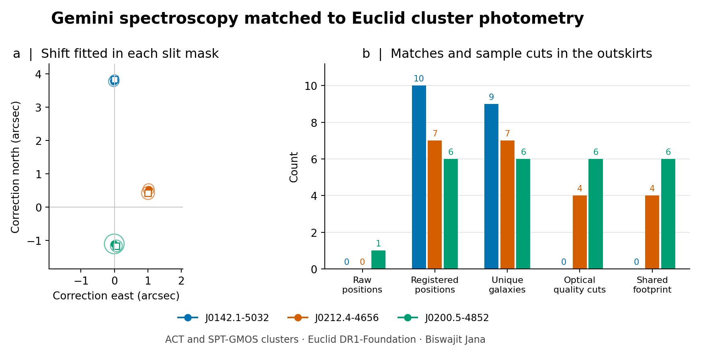

# Independent spectroscopy for the ACT–Euclid cluster comparison

**Biswajit Jana · 19 November 2026**

**Follow-up, 20 November 2026.** [The extension to 15 fields](EXTENSION.md) tests the same footprint selection across all 51 matched galaxies in the SPT-GMOS screen.

I checked whether the [four-field optical-colour pilot](../act-cluster-colour/) could be repeated for galaxies with independent spectroscopic redshifts. The targeted catalogues supplied no usable members in those annuli. I then screened the public SPT-GMOS sample for ACT clusters with spectra in the same radial range and matched the three best-sampled fields to Euclid DR1-Foundation photometry.



*Figure 1.* Each symbol in panel a is a fitted slit-mask translation, with circles showing the RMS core residual when the centre of the offset fit is recalculated with one supporting match omitted. The open and filled symbols distinguish the two slit masks within each field. Panel b counts spectra before and after registration, then counts distinct Euclid galaxies at each selection step.

## Original four fields

ACT DR6 supplies **photometric** cluster redshifts for all four. Within the searched regions, OzDES DR2 returned zero catalogue rows. The single 6dFGS entry has quality code 9 and falls outside the cluster redshift window. The published Ruel and Bayliss SPT spectroscopy tables contain no galaxy redshifts within 2 R500 of the four ACT positions. The NED cone requests timed out, so the search remains limited to the catalogues listed. An annular member-colour fraction for these fields remains undetermined.

Two nearby eRASS1 X-ray systems have photometric redshifts in the optical catalogue. The counterpart to J0434.5−5726 lies 8.3 arcsec away and has $z_{\rm phot}=0.47506$ against the ACT value of 0.425. The counterpart to J0436.5−4450 lies 26.3 arcsec away and has $z_{\rm phot}=0.84040$ against the ACT value of 0.82665. The exact archive queries, catalogue identifiers, and redshift types are recorded with the results.

## Three independently observed follow-up fields

Of 62 SPT-GMOS systems with published spectroscopic cluster redshifts, 50 matched an ACT centre within 2 arcmin and $|\Delta z|/(1+z_{\rm SPT})\leq0.05$. Of these, 25 have centres inside the public Euclid MER Wide Survey footprint. Fifteen have at least one qualifying published spectrum at $1\leq R/R_{500}<2$, with 52 spectra in total under the adopted velocity cut. The three highest-count fields are below. Spectrum counts can include repeat observations of the same galaxy.

| ACT field | SPT spectroscopic z | Annular spectra | Unique Euclid galaxies | Optical red / total | Shared optical and J red / total |
|---|---:|---:|---:|---:|---:|
| J0142.1−5032 | 0.6793 | 10 | 9 | — | — |
| J0212.4−4656 | 0.6535 | 7 | 7 | 3 / 4 | 3 / 4 |
| J0200.5−4852 | 0.4991 | 6 | 6 | 0 / 6 | 0 / 6 |

**Astrometry.** One of the 23 spectra had a unique Euclid counterpart within 0.8 arcsec at the published positions. In the cluster cores, the fitted translations for the six slit masks ranged from **1.09 to 3.83 arcsec**, with leave-one-out RMS residuals of 0.13–0.29 arcsec among their supporting matches. Applying those translations without using the annular sources in the fit produced 23 unique positional matches, corresponding to **22 distinct galaxies** after merging one repeat observation. The largest registered annulus separation was 0.65 arcsec. The eight 15-arcsec control shifts gave 11 unique matches in 184 shifted trials. Rechecking the annulus after registration preserved all 23 spectra.

**Photometry.** The strict optical cut retained ten distinct galaxies in two fields. All ten also passed the shared $J$-footprint and $J$-detection cuts. All nine matched galaxies in J0142.1−5032 carried MER detection-quality bit 512, which marks an extended-object area. Allowing that bit alone, with the other detection flags and band-specific photometry cuts still enforced, recovered seven galaxies there. Four were above the optical colour threshold, and all seven passed the shared footprint. This sensitivity check does not test the accuracy of their photometry inside the flagged area.

The two strict samples give 95% Wilson intervals of 30.1–95.4% for 3/4 and 0–39.0% for 0/6. The spectroscopy was targeted, and these small samples cannot constrain a population red fraction or a survey-wide footprint bias. The direct conclusion is that the $J$ requirement removed no galaxies from the ten strict spectroscopic matches. Here the registration and optical quality cut had the larger effects on which galaxies entered the analysis.

## Method and replay

- Use the published ACT SZ centre and angular $R_{500}$, and the SPT-GMOS cluster redshift for the follow-up fields. Apply $|c(z-z_{\rm SPT})/(1+z_{\rm SPT})|\leq2500$ km/s and keep $1\leq R/R_{500}<2$. The results also give the annular spectrum counts at 1500 km/s.
- For each slit mask, look for bright Euclid sources within 9 arcsec of published spectroscopic positions at $R<R_{500}$. Take the median translation of the best-supported 0.65-arcsec offset group, counting each core spectrum once. Match the independent annular spectra within 0.8 arcsec, require a single counterpart, and use the smaller redshift uncertainty for repeated spectra agreeing within 500 km/s. The group fit is a relative registration of the published coordinates.
- Reuse the optical and $J$ cuts from the [preceding colour analysis](../act-cluster-colour/), including DECam $i\leq23$ AB, red at $r-i\geq0.80$ AB, and a minimum per-band mask weight of 0.80. Where an annulus crosses a tile boundary, combine the two masks and search both MER catalogues.

```bash
python -m pip install -r requirements.txt
python measure_spectroscopy.py
python plot_registration.py
```

The replay uses about 860 MB of public inputs. See [the exact catalogue and mask URLs](inputs.json) and [results, source matches, and input hashes](results/spectroscopy_results.json). The cached NED timeout entries are documented but excluded from the replay.

## Data credits

This work has made use of the Data Release (DR1) data from the Euclid mission of the European Space Agency (ESA). Thanks to the Euclid Consortium and NASA/IPAC IRSA, the ACT/DES/HSC collaborations and NASA LAMBDA, the SPT and Gemini teams, and CDS/VizieR.

- [ACT DR6 SZ cluster catalogue v1.0](https://lambda.gsfc.nasa.gov/product/act/actadv_dr6_szcluster_catalog_info.html).
- Bayliss et al. (2016), [SPT-GMOS](https://doi.org/10.3847/0067-0049/227/1/3), and Ruel et al. (2014), [SPT-SZ optical spectroscopy](https://doi.org/10.1088/0004-637X/792/1/45).
- Lidman et al. (2020), [OzDES DR2](https://cdsarc.cds.unistra.fr/viz-bin/cat/J/MNRAS/496/19), and Jones et al. (2009), [6dFGS DR3](https://cdsarc.cds.unistra.fr/viz-bin/cat/VII/259).
- Kluge et al. (2024), [eRASS1 optical properties](https://erosita.mpe.mpg.de/dr1/AllSkySurveyData_dr1/Catalogues_dr1/KlugeM_DR1/eRASS1_clusters_optical.html).
- [IRSA Euclid DR1 data products](https://irsa.ipac.caltech.edu/euclid-archive-documentation/data-products/), [MER Wide Survey catalogue DOI](https://doi.org/10.26131/IRSA673), and [ESA MER photometry flag definitions](https://euclid.esac.esa.int/dr/dr1/dpdd/merdpd/merphotometrycookbook.html#photometry-flags).
