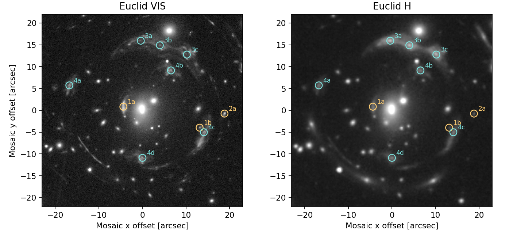
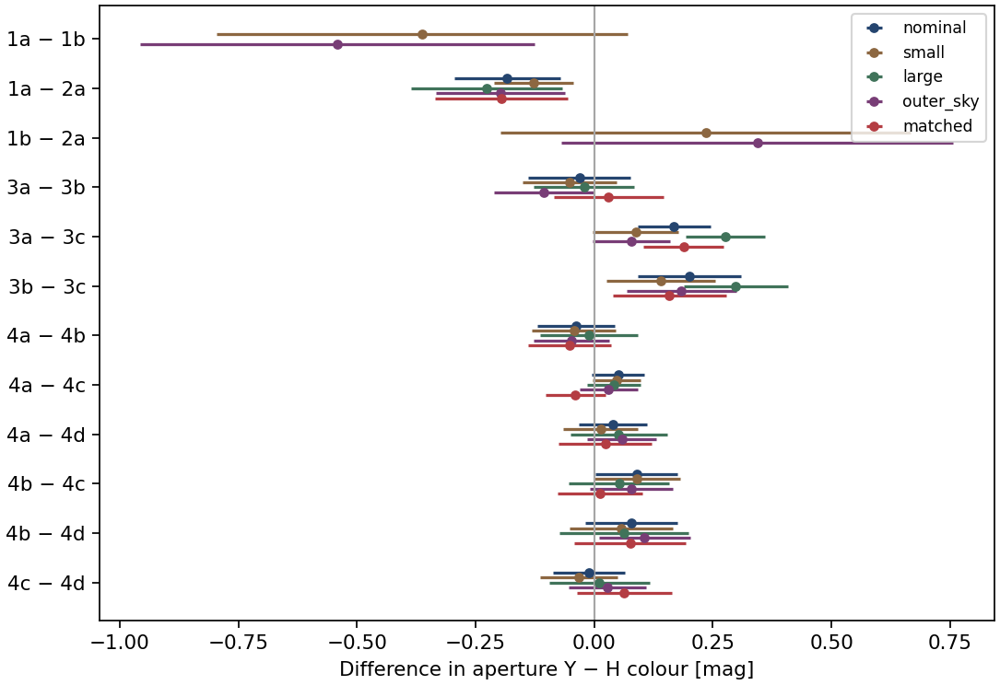

# Can Euclid colours distinguish the near-redshift arcs of the Carousel Lens?

Biswajit Jana · Euclid DR1-Foundation research note · 16 November 2026

## Abstract

The Carousel Lens contains two arcs, 1a and 2a, that look similar in earlier imaging but arise from distinct galaxies near redshift 0.962. We used Euclid DR1-Foundation VIS and NISP mosaics to test whether aperture colours separate them more clearly than genuine multiple images of the same source. The nominal difference in Y−H is −0.184 ± 0.112 mag for 1a minus 2a, with the error estimated from nearby translated apertures. The difference keeps its sign across changes in aperture, background annulus, and approximate point-spread function, but reaches only 1.4–1.6 times the estimated scatter. The true counterimage 1b fails the nominal infrared signal cut, and an independently identified same-source pair, 3b and 3c, shows a nominal absolute Y−H contrast of 0.200 mag. The aperture colours therefore provide insufficient evidence to identify 2a as a separate source. Spectroscopy and lens geometry remain the basis for that identification.

## Introduction

Gravitational lensing conserves surface brightness along a ray in the geometric-optics limit. If two apertures collect corresponding parts of two images of the same galaxy, their colours can agree even when their fluxes differ. In a real observation, differential magnification, colour gradients, foreground light, and the instrument point-spread function (PSF) can change the fraction of each source collected by a fixed aperture.

Sheu et al. (2024) initially considered whether the bright arc 2a counterimaged arc 1a. Their HST lens model instead predicted a faint counterimage at 1b, and MUSE spectra separated the redshifts of 1a and 2a. The published values are 0.96196 ± 0.00001 and 0.96154 ± 0.00003. Their separation is about 64 km s⁻¹ using the small-redshift-difference approximation, Δv = c Δz/(1+z̄). The question here is conditional on those identities: how much evidence for the distinction is present in Euclid aperture colours alone?

The DR1 release overview uses the Carousel field as an illustration. The original Carousel study reports HST modelling and MUSE kinematics, and subsequent papers expand the arc catalogue, fit cosmological parameters and model source kinematics. We checked those studies, the DR1 release papers, and the Euclid Consortium publication portal. NASA ADS search was attempted and returned an inaccessible endpoint in this session. This note makes no priority claim.

## Observations and methods

We used the archive's background-subtracted MER mosaics and flag images in VIS and Y, J, H for wide-survey tile **102034444**. The tile ID was confirmed from the public IRSA HATS Wide Survey catalogue in partition Norder=5, Npix=5126. The catalogue was used for locating the tile, while the photometry below was measured directly on the mosaics. The [product list](data/products.json) records the eight S3 keys and the [cutout index](data/cutout_index.json) records pixel checksums and the fetched byte intervals. Each image is a 56″ square on the mosaic's 0.1″ grid. NISP's native sampling is coarser than the mosaic grid.

We fixed the centres at the published coordinates in O’Donnell et al. (2026), Table 2. The [position table](data/arcs.csv) transcribes all listed positions, including tentative entries used only as exclusion positions for background apertures. We measured arcs 1a, 1b, 2a, 3a–3c, and 4a–4d. Arc 1b is the primary same-source control, and arcs of sources 3 and 4 provide additional comparison pairs.

The nominal source aperture has a radius of 0.8″. We fit a clipped background plane to pixels between 1.25″ and 2.25″, excluding pixels within 0.8″ of other literature centres. We kept finite pixels with the lowest flag bit clear and required at least 95% valid source-aperture pixels. The empirical local scatter came from up to 36 translated apertures at radii of 4″, 7″, and 10″ using the same background estimator. We retained a colour difference only when all four contributing fluxes exceeded three times their local scatter. The nominal measurement and four sensitivity cases are recorded in the [protocol](protocol.md).

For band X and aperture flux F, the reported contrast is Δ(X−H) = −2.5 log₁₀[(Fₓ,ₐ/Fₕ,ₐ)/(Fₓ,ᵦ/Fₕ,ᵦ)]. A spatially constant zeropoint per band cancels. First-order propagation uses the four empirical flux scatter estimates in quadrature. The error scale assumes independent flux errors; nearby controls share pixels and background structure and cross-band covariance was not estimated. The quoted errors are approximate. For one sensitivity case we smooth with Gaussian kernels to a nominal common FWHM of 0.85″, from survey-wide FWHM estimates of 0.18″, 0.49″, 0.51″, and 0.56″ in VIS, Y, J, and H. This tests sensitivity to seeing different amounts of the arcs and is not a local PSF calibration.



*The circles mark the nominal 0.8″ apertures. Gold marks the near-redshift comparison and its counterimage control. Cyan marks the additional same-source controls. The panels use separate display stretches.*

## Results

| Pair | Published identity | Nominal VIS−H | Nominal Y−H | Nominal J−H |
|---|---|---:|---:|---:|
| 1a − 1b | Same source | — | — | — |
| 1a − 2a | Distinct sources | −0.115 ± 0.087 | −0.184 ± 0.112 | −0.097 ± 0.113 |
| 3a − 3c | Same source | +0.511 ± 0.219 | +0.168 ± 0.077 | +0.131 ± 0.061 |
| 3b − 3c | Same source | +0.689 ± 0.250 | +0.200 ± 0.109 | +0.019 ± 0.079 |
| 4a − 4c | Same source | +0.076 ± 0.047 | +0.050 ± 0.055 | +0.026 ± 0.052 |

*Values are differences in magnitudes. The dash means at least one band failed the aperture signal threshold.*

At the nominal aperture, 1b has approximate local signal-to-scatter ratios of 10.1 in VIS, 2.64 in Y, 2.49 in J, and 2.58 in H. It is also only 1.43″ from arc 4c. The 0.65″ aperture and the wider background annulus yield 1a−1b colours with errors above 0.4 mag in Y−H. Those two alternatives are too noisy to calibrate a small contrast.

For 1a−2a, the Y−H contrast varies from −0.127 to −0.227 mag across the five configurations. Its local error varies from 0.084 to 0.160 mag. In the approximate common-PSF case the contrast is −0.195 ± 0.140 mag. For same-source control images 4a–4d, all six nominal absolute Y−H contrasts are below 0.090 mag. The source 3 comparison gives a different scale: 3b−3c differs by 0.200 mag in nominal Y−H, comparable to the contrast of the known distinct pair.



*Points show the results of alternate reductions of the same data. They are sensitivity checks and should not be combined as independent estimates. Missing points fail the signal threshold.*

## Discussion

The sign of the bright pair's colour difference is stable to the reductions tried here. Its amplitude overlaps the nominal differences measured between images of a single source. The counterimage that most directly tests the question is too faint in the nominal NISP apertures. These data constrain what can be inferred from local Euclid aperture colours in this field. They do not independently determine the source identities or test whether apertures correspond in the source plane. The diagnostic also cannot distinguish a real source-plane colour gradient from neighbouring light or uneven magnification across the aperture.

The primary limiting measurement is 1b. A source-plane comparison using a published lens model and a joint image fit would estimate whether the apertures sample corresponding regions. A local, band-specific PSF and a forward model for arc 4c would help determine how much the proximity of the two images affects the comparison.

The spectral identifications and velocities cited here come from published MUSE work, programme 0111.B-0400(H). This analysis did not use an extracted spectrum or remeasure any redshifts. The field image and the colour measurements come from Euclid DR1-Foundation.

## Reproduce

Use Python 3.12 with [the analysis dependencies](analysis/requirements.txt). The archive script downloads byte ranges from the eight mosaics, about 345 MB in total, and writes the smaller local FITS cutouts. Raw FITS files are outside this repository.

```bash
python analysis/fetch_cutouts.py --products data/products.json --output /tmp/carousel-cutouts
python analysis/measure.py --data /tmp/carousel-cutouts --arcs data/arcs.csv --output /tmp/carousel-results
```

Compare the generated cutout index against [the checked-in index](data/cutout_index.json), and the output tables against [apertures](data/apertures.csv) and [colour differences](data/colour_differences.csv). An empty measurement denotes a failed cut. The figure files are displayed above.

## References and data credit

- Sheu et al. (2024), *The Carousel Lens: A Well-Modeled Strong Lens with Multiple Lensed Sources*. [Paper](https://doi.org/10.3847/1538-4357/ad65d3) · [arXiv](https://arxiv.org/abs/2408.10320)
- O'Donnell et al. (2026), *The Carousel Lens I: A Spectroscopic Survey of the Carousel Lens Field*. [Paper](https://doi.org/10.33232/001c.170181) · [Catalogue coordinates, Table 2](https://arxiv.org/abs/2601.14422v3)
- Urcelay et al. (2026), *The Carousel Lens II: Cosmological Constraints with GIGA-Lens*. [arXiv](https://arxiv.org/abs/2602.16077)
- Sheu et al. (2026), *The Carousel Lens III: Joint lens convergence and source kinematic modeling using MUSE integral-field unit data*. [arXiv](https://arxiv.org/abs/2610.37971)
- Euclid Collaboration, Aussel et al. (2026), *Euclid First Data Release 1 (DR1): Data release overview*. [arXiv](https://arxiv.org/abs/2611.16510) · [Data release supplement](https://euclid.esac.esa.int/dr/dr1/expsup/)
- Euclid Collaboration, Nersesian et al. (2026), *ECLIPSE D: Photometric redshifts and the first census of strong lenses in the galaxy evolution framework*. [arXiv](https://arxiv.org/abs/2611.15877)
- Images from ESA/Euclid/Euclid Consortium/NASA. MER mosaics accessed via NASA/IPAC IRSA. [Dataset DOI](https://doi.org/10.26131/IRSA683)
