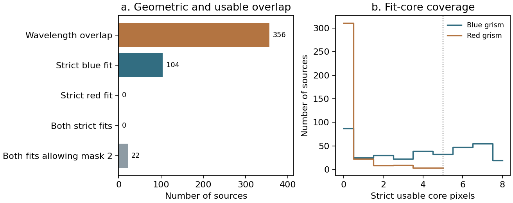
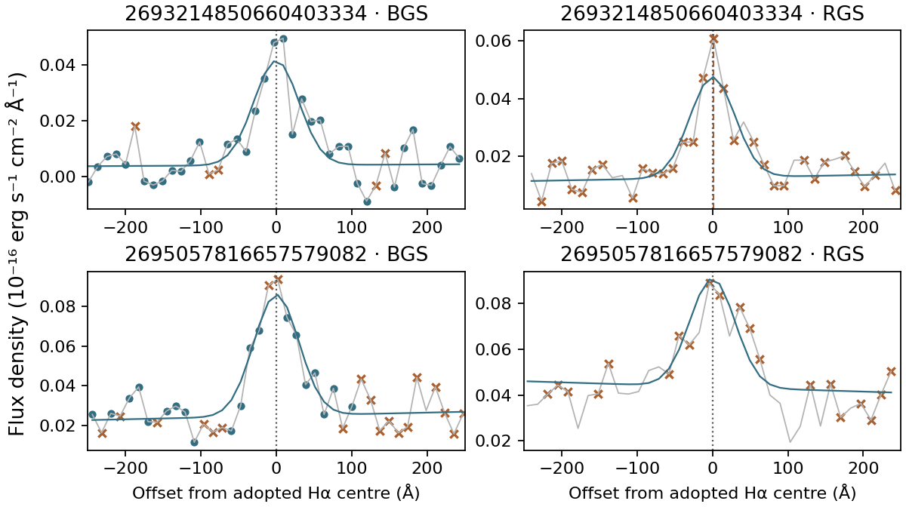

# Usable Hα coverage in the Euclid NISP grism overlap

Biswajit Jana · Day 3 · Euclid Deep Field North · 15 November 2026

> This component is included in the [combined EDF North Hα study](../edf-north-halpha/).

[Download the A&A-format research report](report/Euclid_Day_3.pdf) · [LaTeX source](../manuscripts/day3.tex)

## Abstract

**Context.** The blue and red NISP wavelength grids overlap. Pixel quality and continuum coverage determine whether both grisms can measure the same line region.

**Aims.** Measure the fraction of the selected sample with usable dual coverage, then test the stability of warning-inclusive Hα-region fits.

**Methods.** Three checksum-verified DR1 SIR HATS partitions provide paired spectra for 858 objects. Fits use a local linear continuum and a 30 Å Gaussian at the Euclid spectroscopic redshift. A separate mask selection admits pixels with the low-S/N warning. The sensitivity tests remove the strongest usable red core bin or move the template to an independent DESI redshift.

**Results.** For the 356 targets with both full fit windows on the wavelength grids, 104 admit a strict blue fit and zero admit a strict red fit. With the warning admitted, 22 targets have dual fits and 14 reach adjusted S/N ≥5 in both spectra. Removing one red core bin leaves five above threshold, one below it, and eight without fit coverage. Two retain a dual detection at an independent DESI redshift. No candidate passes both the DESI-centre and peak-removal checks.

**Conclusions.** Geometric wavelength overlap substantially overstates strict usable overlap in this sample. The warning-inclusive subset gives specific targets for exposure-level validation.

## 1. Introduction

The overlap of NISP grisms allows a line feature to be checked in two separate extractions. These measurements can still share calibration and catalogue inputs. Trace overlap and quality masks can make portions of a nominal wavelength range unusable. Hα may also blend with [N II]. The fit therefore measures the Hα region under a fixed template and cannot recover independent line ratios. The parent sample was selected using Euclid pipeline Hα, so this is a repeatability and coverage study rather than a blind line search. [Aussel et al. (2026)](https://arxiv.org/abs/2611.16510) · [Fumana et al. (2026)](https://arxiv.org/abs/2611.17305) · [Gabarra et al. (2026)](https://arxiv.org/abs/2611.16504) · [Copin et al. (2026)](https://doi.org/10.1051/0004-6361/202554627)

## 2. Sample and methods

Of 1,576 Day 2 objects, 858 fall in the three examined IRSA HATS partitions and have one combined blue and one combined red spectrum matched by exact MER object and tile ID. Their SPE redshifts define the expected wavelength, λ = 6564.61 Å × (1 + z). The analysis requires the full ±250 Å window to be on both wavelength grids. A strict usable pixel has mask 0, quality >0.8, positive variance, and at least one contributing extraction. Each fit requires at least five usable core pixels and at least 60% coverage within ±45 Å, sampling on both sides of line centre, and five usable samples in each 125–250 Å continuum sideband. The alternate rule adds only pixels with mask 2.

The adjusted S/N divides the formal diagonal-variance S/N by the larger of one and the sideband residual RMS measured in noise units. The two-grism screening threshold is adjusted S/N ≥5 in each grism. For each warning-inclusive dual candidate, the red-core sample with the largest flux-density excess above the fitted continuum is removed before repeating the fit. A separate test recomputes both centres using unique primary DESI galaxy matches within 0.2″. The two tests probe different sensitivities. Individual spectra within each grism and pixel-to-pixel covariance were not modelled in this pass. [DESI Collaboration (2025)](https://arxiv.org/abs/2503.14745)

## 3. Results

| Selection at catalogue Hα centre | Strict | Including mask 2 |
|---|---:|---:|
| Both full fit windows on the wavelength grids | 356 | 356 |
| Blue fit available | 104 | 180 |
| Red fit available | 0 | 46 |
| Both fits available | 0 | 22 |
| Both adjusted S/N ≥5 | 0 | 14 |

Of the 858 paired objects, 407 have the predicted centre on both grids and 356 also have the full nominal overlap window. In the strict red selection, 311 of the 356 objects have zero usable core bins. In total, 353 have fewer than five usable core bins and 355 have fewer than five samples in at least one sideband. Those counts overlap. Fifty-four of the 104 strict blue fits reach adjusted S/N ≥5. Strict fits centred at offsets of ±300 and ±440 Å yield no dual usable fits either. The offset check cannot estimate a false-positive rate for the warning-inclusive candidates.



*Figure 1. Left: attrition from geometric overlap to usable fits. Right: distribution of strictly usable pixels in the ±45 Å line core, with the minimum pixel count indicated by the dotted line.*

Five warning-inclusive red fits remain above S/N 5 after removing the brightest red core bin. Eight cannot be fit under the coverage rule after that removal, so their stability is undetermined. One fit remains measurable but falls below the threshold. Three of the 14 warning-inclusive candidates have a unique DESI galaxy match within 0.2″, and two meet the dual threshold after re-centring. Those two both lose fit coverage under the separate, SPE-centred peak-removal test.

| Example | Result | What remains open |
|---|---|---|
| `2693214850660403334` | The strongest peak-removal survivor has adjusted red S/N **9.17**, down from **12.24**. The blue adjusted S/N is **10.31**. | No unique DESI galaxy match within 0.2″. The spectrum should be checked against individual red orientations and the contamination model. |
| `2695057816657579082` | At independent DESI z = **0.905244**, adjusted S/N is **13.29** in blue and **9.23** in red. | The separate SPE-centred bin-removal test leaves insufficient red coverage. |
| `2700933273661649762` | The warning-inclusive blue and red adjusted S/N values are **42.65** and **46.63**. | Removing one red bin leaves insufficient coverage. The large combined S/N alone cannot establish repeatability. |



*Figure 2. Top: the highest-S/N peak-removal survivor, shown at its SPE centre before removing the red bin marked by the dashed line. Bottom: the strongest dual fit at an independent DESI centre. Crosses mark usable pixels admitted by mask 2. The dotted line marks the adopted Hα centre.*

## 4. Discussion and conclusions

The strict null result is caused by fit-window quality and coverage. It gives no estimate of the intrinsic Hα detection rate or a blue–red flux offset. The 14 warning-inclusive detections are conditional on the adopted template, masks and sample selection. The five red survivors provide a bounded list for testing individual exposures, dispersion orientations and wavelength-dependent contamination. The DESI matches test redshift placement for a separate subset. This pass identifies no new astrophysical object or redshift.

## Data availability and reproduction

The [analysis script](analysis/compare_grisms.py) uses the checked-in Day 2 parent and DESI tables plus three archived SIR partitions with checksums. It writes the [coverage summary](analysis/overlap_summary.json), [all fit diagnostics](analysis/overlap_fits.csv.gz), and [peak-removal table](analysis/peak_removal.csv). The run used Python 3.12. The cache holds approximately 2.2 GB of public archive inputs.

```bash
python -m pip install astropy==8.0.2 cdshealpix==0.9.0 matplotlib==3.10.8 numpy==2.3.5 pandas==3.1.1 pyarrow==26.0.1
python euclid-dr1-foundation/day03-cross-grism/analysis/compare_grisms.py --cache /path/to/sir_cache
```

The source products are the [IRSA DR1 SIR combined spectra](https://doi.org/10.26131/IRSA680), [MER Deep](https://doi.org/10.26131/IRSA675), [SPE galaxy candidates](https://doi.org/10.26131/IRSA696), and [DESI DR1](https://data.desi.lbl.gov/doc/releases/dr1/). This work has made use of Data Release 1 from the Euclid mission of ESA, distributed through NASA/IPAC IRSA.
