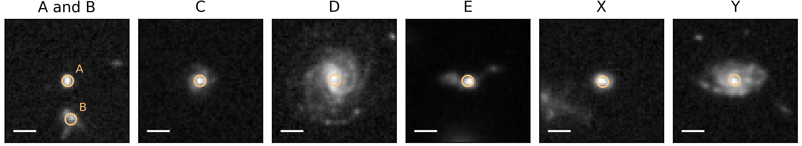
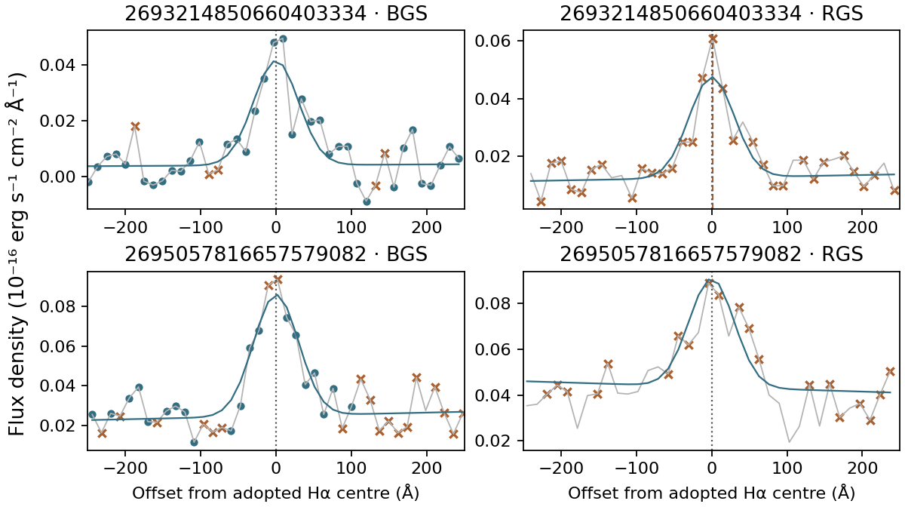

# Hα measurements and optical aperture sizes in Euclid Deep Field North

Biswajit Jana · 15 November 2026

[Study PDF](report/Euclid_EDF_North_Halpha.pdf) · [LaTeX source](report/Euclid_EDF_North_Halpha.tex)

## Abstract

We use Euclid DR1-Foundation images and spectra to examine the association between measured Hα flux and optical aperture radius in a 0.28° field. The contrast between higher- and lower-flux emitters is +0.05166 dex in MER Kron radius for 782 imaging-quality sources. A comparison within tiles using direct VIS radii and reliable red-grism Hα gives +0.01402 dex for 398 sources, with whole-tile bootstrap endpoints of −0.0173 to +0.0443 dex. In the spectral overlap, no source passes the strict fit in both grisms. Including pixels with the low-S/N warning yields 14 dual detections and five remain above threshold after removing the strongest red-core bin. The measurements give an inconclusive size comparison and a set of sources for independent spectral checks.

## 1. Field and measurements

The pilot is a cone centred at ICRS RA 269.733°, Dec +66.018°. Selection uses positive rank-0 Hα flux at S/N ≥5, 0.90 ≤ z ≤ 1.50, redshift probability ≥0.99, and positive VIS aperture flux. All 1,576 selected objects match original MER catalogues over eight tiles. The imaging cuts retain 782 with positive Kron radius, zero VIS and detection-quality flags, and spurious probability below 0.5. The earlier 0.15° cone overlaps the larger field. It provided morphology for 327 of 426 selected galaxies, of which 150 passed the imaging cuts. The available clean sample fell below its predeclared minimum of 200.



*Figure 1. Released background-subtracted MER VIS mosaics. Rings mark catalogue positions and the bars show 1″. Each tile cutout uses its own display stretch.*

## 2. Aperture-radius contrast

Within redshift and VIS-flux strata, we compare medians of log₁₀ aperture radius between the higher- and lower-Hα halves, weighting the differences by cell size. Direct radii enclose half the signed, sky-subtracted VIS flux within 1.5″. For the direct comparisons we also construct cells within tiles, require at least five objects in each Hα half, and resample tiles in 4,000 draws. Five tiles contribute eligible cells at the 2.0″ neighbour exclusion. The reliable-red measurement uses SPE Gaussian-fit code 212.

| Size and line flux measurement | N | Contrast (dex) | 95% bootstrap endpoints (dex) | Resampling unit |
|---|---:|---:|---:|---|
| MER Kron radius, catalogue median Hα | 782 | +0.05166 | +0.0204 to +0.0761 | Object |
| Direct VIS radius, catalogue median Hα | 398 | +0.03363 | −0.0116 to +0.0710 | Tile |
| Direct VIS radius, reliable red-grism Hα | 398 | +0.01402 | −0.0173 to +0.0443 | Tile |
| Direct VIS radius, reliable red-grism Hα with 2.5″ isolation | 233 | +0.01719 | −0.0211 to +0.0624 | Tile |

Changing the flux estimate for the same 398 objects reduces the measured contrast by 0.01961 dex. The reliable-red estimate corresponds to a +3.3% difference in the aperture-radius ratio, with descriptive endpoints of −3.9% and +10.7%. Adjacent tiles may share systematics. The aperture depends on the PSF and light profile, and selection on detected Hα limits population inference.

## 3. NISP coverage and candidate measurements

Three checksum-verified SIR partitions supply 858 matched blue/red spectra. Of these, 356 have a full ±250 Å nominal window in both around the SPE-predicted Hα centre. We fit a 30 Å Gaussian plus a linear continuum. Usable fits require at least five usable bins and 60% coverage of the ±45 Å core, sampling on both sides, and at least five valid bins in each continuum sideband. The strict rule requires mask 0 and quality >0.8. The alternate rule also admits mask 2, the documented low-S/N warning. The adjusted S/N downweights fits when continuum residual scatter exceeds the per-bin noise. The template can include [N II].

| Grism fit result | Strict cuts | Including mask 2 |
|---|---:|---:|
| Full nominal windows in both grisms | 356 | 356 |
| Usable blue fit | 104 | 180 |
| Usable red fit | 0 | 46 |
| Usable in both | 0 | 22 |
| Adjusted S/N ≥5 in both | 0 | 14 |

Applying the same warning-inclusive fit at offsets of −440, −300, +300 and +440 Å yields 23, 21, 26 and 17 usable dual windows, respectively, with zero dual results at adjusted S/N ≥5. Only one source is usable at all five centres. The offset windows can overlap within an object, and usable coverage varies by centre, so the result supplies a control comparison without an empirical false-positive rate. Of the 14 centred candidates, five remain above threshold after removing the strongest red-core bin, one falls below it, and eight lose sufficient coverage to refit. Two give dual detections at independent DESI redshifts. Both of those lose sufficient red coverage under the separate SPE-centred bin-removal test.



*Figure 2. Top row, X at the SPE centre. Bottom row, Y at the DESI centre. Crosses mark usable pixels admitted by the warning-inclusive rule. The dashed line shows the red bin removed for X.*

| Image label | Euclid MER ID | Measurement |
|---|---|---|
| A | `2700686070662453859` | Adjusted Hα-region and [O III] S/N of 14.02 and 12.69. |
| B | `2700684940662448691` | Lies 1.868″ from A. Both appear in Subaru HSC and Q1. The six Hα core bins carry mask 2 and the warning-inclusive S/N is 4.50. The redshift and any physical association with A remain uncertain. |
| C | `2697432168658721533` | Positive Hα-region flux in all 12 usable individual red extractions. |
| D | `2693965274658805116` | Formal Hα-region S/N drops from 21.23 to 1.14 after one flagged bin is removed. |
| E | `2703247763660016093` | DESI gives z = 0.975547 compared with Euclid z = 0.975754. |
| X | `2693214850660403334` | Blue and red adjusted S/N are 10.31 and 12.24. Removing the peak red bin leaves S/N 9.17. |
| Y | `2695057816657579082` | At independent DESI z = 0.905244, adjusted S/N is 13.29 and 9.23. |

The population inference remains inconclusive. The source-level results distinguish repeatable features, warning-dominated fits and coverage failures. Exact-ID web searches for A, B, X and Y returned no identifiable source-specific publication. This search is limited to indexed text and misses possible catalogue aliases. The results support further checks on individual sources and do not establish a new object, redshift or physical association.

## Data and code

Install the [Day 3 Python environment](../day03-cross-grism/#data-availability-and-reproduction). From the repository root, regenerate the target plate from the archived FITS cutouts and repeat the same-mask offset audit.

```bash
python euclid-dr1-foundation/edf-north-halpha/analysis/image_targets.py
python euclid-dr1-foundation/edf-north-halpha/analysis/audit_warning_offsets.py --cache /path/to/sir_cache
```

The [target FITS cutouts](analysis/target_vis_stamps.fits.gz), [image manifest](analysis/target_vis_manifest.json), [offset fit table](analysis/warning_offset_fits.csv.gz), and [offset counts](analysis/warning_offset_summary.json) accompany this study. The [archived morphology and source tests](../2026-11-15-day02/analysis/) and [centred spectra and fits](../day03-cross-grism/analysis/) supply the other measurements. To rebuild the PDF, run this from the report directory with a standard TeX Live installation.

```bash
pdflatex Euclid_EDF_North_Halpha.tex
BIBINPUTS=../../manuscripts: bibtex Euclid_EDF_North_Halpha
pdflatex Euclid_EDF_North_Halpha.tex
pdflatex Euclid_EDF_North_Halpha.tex
```

[Euclid DR1 overview](https://arxiv.org/abs/2611.16510) · [DR1 SIR calibration](https://arxiv.org/abs/2611.17305) · [NISP emission-line maps](https://arxiv.org/abs/2611.16504) · [DESI DR1](https://arxiv.org/abs/2503.14745). Observations were obtained from ESA's Euclid mission through NASA/IPAC IRSA, Subaru HSC, and DESI DR1.
