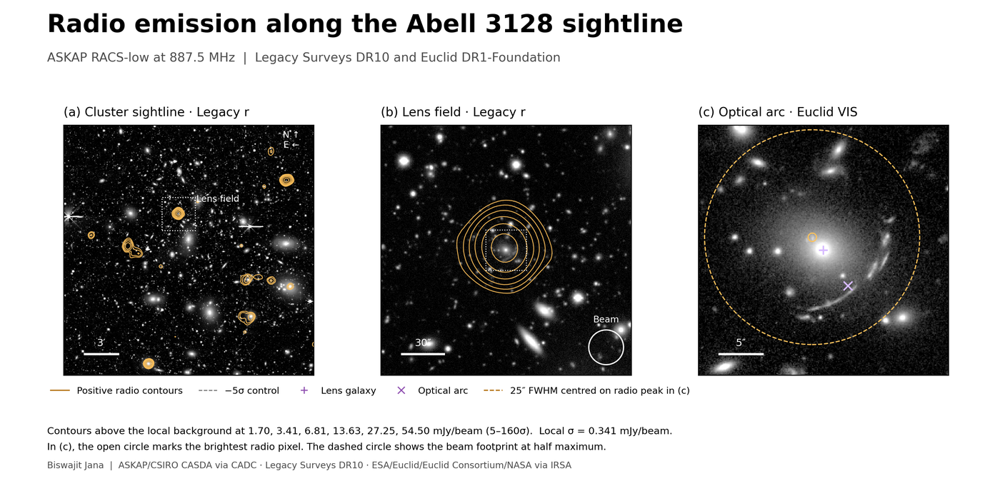

# Abell 3128 sightline at 887.5 MHz

Analysis and figure preparation: Biswajit Jana · 19 November 2026.

The two radio cutouts are public ASKAP RACS-low DR1 Stokes I mosaics at the
common 25 arcsec FWHM. The map measurements use the native 2.5 arcsec pixel
grid. For each tile, background and noise are the median and 1.4826 × MAD in
a 75–280 arcsec annulus about the DES lens, iteratively clipped at 3 sigma.
The figure uses RACS-DR1_0304-50A, with contours at 5, 10, 20, 40, 80 and
160 sigma and a dashed −5 sigma control. Contour coordinates are transformed
via the FITS WCS. The optical image stretch is for display. No shifts were
fitted between datasets.

The second overlapping tile checks how the measurements change with tile
choice. The two tiles may share input observations. The brightest native
radio pixels within 30 arcsec of the DES lens centre lie about 2 arcsec
from that centre and yield 78.42 and 78.27 mJy/beam above the local background.
These peak-pixel values are neither fitted positions nor integrated fluxes.
The approximately 5.02 arcsec lens–arc separation is much smaller than the
radio beam. The circle in the Euclid panel represents the beam FWHM and
places the optical features in scale context. It is not a flux contour or
an astrometric error circle. The −5 sigma contour is a negative brightness
control, which can include imaging sidelobes.

## Inputs

- [RACS-low DR1 common-resolution products](https://cadcftp.cadc.hia.nrc-cnrc.gc.ca/en/racs/).
  CADC SODA endpoint: https://ws.cadc-ccda.hia-iha.nrc-cnrc.gc.ca/caom2ops/sync .
  IDs: casda:RACS/RACS-DR1_0304-50A.fits and casda:RACS/RACS-DR1_0310-56A.fits .
  CIRCLE = 52.712 −52.525 0.31 in degrees. McConnell et al. (2020),
  doi:10.1017/pasa.2020.41, and Hale et al. (2021), doi:10.1017/pasa.2021.47.
  ASKAP/CSIRO CASDA archive data, CC BY 4.0.
- [Legacy Imaging Surveys DR10](https://www.legacysurvey.org/dr10/description/),
  viewer FITS cutouts, layer ls-dr10, bands=r. The wide cutout is centred at
  (52.712, −52.525) degrees with 720 pixels at 2 arcsec/pixel. The lens cutout
  is centred at (52.737216, −52.470283) degrees with 500 pixels at
  0.4 arcsec/pixel. [Legacy Surveys acknowledgments](https://www.legacysurvey.org/acknowledgment/).
- Euclid VIS comes from the preceding calibrated IRSA MER tile 102017310
  cutout. The product ID is in [the archive manifest](../inputs/arc_image_manifest.json)
  and the cutout hash is in [the FITS checksums](../inputs/fits_sha256.json).
  Euclid imaging credit: ESA/Euclid/Euclid Consortium/NASA.
- Lens and arc coordinates: Nord et al. (2016), Table 2,
  [doi:10.3847/0004-637X/827/1/51](https://doi.org/10.3847/0004-637X/827/1/51).

## Higher-resolution ATCA

The ATOA query returned source ACT0330-5227, project C2457, PI A. Baker,
2011-12-13, array 6A. Matching raw files:
2011-12-13_0631.C2457, 2011-12-13_1004.C2457, 2011-12-13_1329.C2457,
2011-12-13_1653.C2457. See the [ATOA query form](https://atoa.atnf.csiro.au/query.jsp)
and [Lindner et al. (2015), Tables 3–4](https://doi.org/10.1088/0004-637X/803/2/79).
The raw visibilities require an OPAL account for download. The calibrated
LASCAR 2.17 GHz image was not available in the records inspected, and no
ATCA data were used to draw these contours.

## Reproduce

Run from this directory with Python 3.11 or later. The parent archive
script acquires the Euclid and DECam cutouts for the optical analysis.
Reuse an existing `../inputs/arc_VIS.fits` if available.

    python -m pip install -r ../requirements.txt
    python ../get_arc_fits.py ../inputs  # skip if the VIS cutout already exists
    python fetch_inputs.py
    python overlay.py

[Figure PDF](results/Abell3128_Radio_Optical.pdf) ·
[Measurements and FITS hashes](results/radio_measurements.json)

