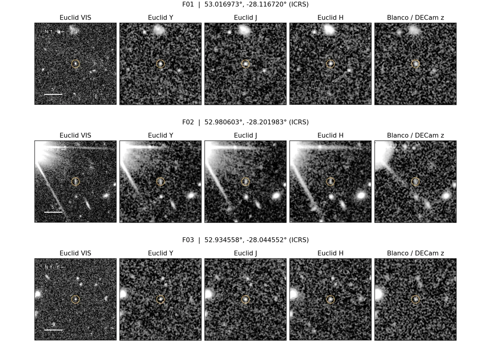

# Faint near-infrared colour outliers in Euclid Deep Field Fornax

Biswajit Jana · 16 November 2026 · distinct study · editorial day unassigned

**Abstract.** We used public Euclid DR1-Foundation MER Deep Survey photometry to ask whether faint sources in a published T-dwarf colour box retained those colours when measured with a PSF-matched aperture. In a 0.125° radius field and the range 23 &lt; J ≤ 24 AB, 28 of 1,413 quality-selected objects entered the box with template-fit fluxes. Thirteen retained nominal aperture colours (46.4%, Wilson 95% interval 29.5–64.2%), and zero satisfied the preregistered uncertainty and signal-to-noise criteria. Independent Blanco/DECam z imaging and VISTA/VIRCAM VIDEO photometry support real sources near the three highest-ranked positions. Their VIDEO J−H colours are less blue than the Euclid aperture estimates, measured through different passbands. A bright-star halo and diffraction are present near one candidate. The run constrains colour-selection stability in this footprint and leaves object classes, redshifts and distances unresolved.

[Preregistered protocol](PROTOCOL.md) · [Exploratory template methods](TEMPLATE_CHECK.md) · [Scientific PDF](Euclid_Fornax_Colour_Outliers.pdf) · [Candidate register](results/candidate_register.csv) · [Release and data access](https://irsa.ipac.caltech.edu/data/Euclid/docs/overview_dr1.html)



Above, each panel covers about 24 arcsec, with north up and east left. The ring marks the MER position, and each image has an independent stretch. Registration uses the delivered FITS WCS, with no additional local astrometric fit. The pixel scale of the common grid is 0.13 arcsec. Native MER sampling is 0.1 arcsec and the independent DECam request uses 0.262 arcsec pixels. Native PSFs are retained. Euclid VIS and DECam z therefore support a positional optical comparison only. The latter samples a redder part of the spectrum at lower angular resolution. Local blank-aperture contrasts for DECam z are 10.29, 6.31 and 9.10, respectively, in 1.6 arcsec diameter apertures, using the median and MAD over nearby apertures. These empirical contrasts are sensitive to neighbours and the local halo. They are neither point-source depth estimates nor calibrated detection probabilities. All five cutout planes cover each target.

## Colour screen

| Stage | Rows |
|---|---:|
| MER rows in field before the J cut | 21,971 |
| In the preregistered J range | 3,458 |
| Primary rows after exact-ID and 0.3 arcsec positional grouping | 3,458 |
| Detection and near-IR flags clear, no MER deblend parent | 2,676 |
| Template-fit Y/J/H S/N ≥ 10 | 1,413 |
| Comparison sample | 1,385 |
| Nominal template-fit candidates | 28 |
| Still inside with nominal aperture colours | 13 |
| At least 2 propagated σ from all aperture boundaries, aperture S/N ≥ 5 | 0 |

The IRSA TAP schema and HATS column metadata identify both flux estimates in µJy. For AB magnitudes use 23.9 − 2.5 log10(flux/µJy). The aperture uses diameter twice the PSF-matching FWHM. Both estimators use Euclid data, with correlated selection and measurement errors. The uncertainty margin includes the preregistered 0.03 mag error floor and conservative sum of single-band errors for each colour. The largest minimum boundary margin was 1.09 σ. The geometric area is 0.0491 deg². The attrition and interval describe this screened catalogue, without a completeness correction for footprint, depth, blending or sources with missing photometry. Comparison objects meet the same J, S/N and flag criteria. [Colour plot](results/colour_screen.png) · [Quality table](results/full_quality_table.csv.gz)

## Candidate checks

| ID | RA (ICRS) | Dec (ICRS) | MER object ID | Euclid aperture J−H | VIDEO J−H | VIDEO source ID / match |
|---|---:|---:|---|---:|---:|---|
| F01 | 53.016973° | −28.116720° | −530169732281167197 | −0.488 ± 0.313 | +0.058 ± 0.093 | 644247524531 / 0.428″ |
| F02 | 52.980603° | −28.201983° | −529806031282019831 | −0.608 ± 0.297 | +0.167 ± 0.147 | 644248076048 / 0.140″ |
| F03 | 52.934558° | −28.044552° | −529345576280445515 | −0.395 ± 0.360 | +0.045 ± 0.109 | 644247549515 / 0.252″ |

Euclid uncertainties are the preregistered conservative bounds. VIDEO uncertainties are quadrature catalogue errors, excluding unknown covariance and systematics. VIDEO DR5 uses 3 arcsec aperture-3 AB photometry from ESO VISTA/VIRCAM (programme 179.A-2006). VIRCAM passbands are narrower and have different transmission, so a raw colour difference is descriptive. F01 and F03 look compact in VIS. F02 is elongated in MER (ellipticity 0.720) and lies in a field with a bright halo, diffraction and neighbours. The registered images and optical detection support real light near its position while leaving the cause of the abnormal colour open. Image inspection and MER flags did not reveal a bad pixel at the target locations, but detector-level persistence, moving objects and variability were not tested with individual visits. [Image FITS metadata and checksums](results/archive_audit.json) · [Independent catalogue responses](results/external_audit.json)

Gaia DR3 returned no entries within 10 arcsec of these Euclid positions. CatWISE2020 W1/W2 returned one 9.929 arcsec neighbour near F02. Its reported motion components are below 2σ individually, and the neighbour is too distant for a credible match with those motions. VHS DR5 returned no entries within 10 arcsec. Its typical depth (J_AB ≈20.8–21.4) makes that result uninformative for these faint targets, with local VHS imaging coverage unverified. These are catalogue searches and supply no usable parallax or motion constraints.

The DR1-F PHZ catalogue includes all three candidates. Its stellar flag is set for F01/F03 and its galaxy flag for F02. Pipeline classes are recorded as metadata only. The galaxy PHZ medians are 0.52, 2.69 and 0.63, respectively. SPE classification and galaxy-candidate lookups returned zero exact-ID rows. For F02 the SIR archive contains both blue and red grism coadds. Within the finite-variance wavelength segments the zero-mask rule retains 303 of 335 blue and 452 of 523 red bins. The maximum absolute per-bin formal S/N in the zero-mask subsets is 3.09 (blue) and 4.96 (red). These are complementary Euclid products in separate wavelength ranges with some overlap. Low-S/N and contaminated regions, crowding and correlated noise preclude a secure line or repeat-visit detection claim from this inspection. F01 and F03 had no SIR rows at their exact IDs in the searched HATS data. [F02 spectra](results/audit/F02/spectrum.png) · [SIR masks and flux arrays](results/nisp_spectra.json)

## Flux-space comparison

A secondary, exploratory fit used optical and near-IR fluxes, separate Euclid and VIDEO normalizations, Galactic E(B−V) = 0.0073 from the IRSA Schlafly–Finkbeiner map and a 5% per-band error floor. Filter response integration accounts for non-equivalent passbands. The absent usable F02 VIDEO Z flux was omitted because a local limiting flux was unavailable. Near-IR-only fits of the two observed mid-T standards gave χ² ≈47, 91 and 79 for F01/F02/F03, compared with ≈13, 9 and 5 for the best alternatives under the same band and normalization rules. This sensitivity check covers two mid-T spectra and a limited set of galaxy, ordinary-star and QSO templates.

| ID | Euclid PHZ galaxy median | Best optical+near-IR galaxy z | Descriptive galaxy Δχ² ≤ 4 grid components | Interpretation |
|---|---:|---:|---|---|
| F01 | 0.52 | 0.00 (grid boundary) | 0.00–0.06 | Stellar and galaxy fits have nearly equal χ² (20.79 and 21.10) |
| F02 | 2.69 | 1.12 | 1.00–1.18 | Halo and blend risk, broad-band estimates disagree |
| F03 | 0.63 | 1.24 | 0.12–0.20, 0.26–0.94, 1.18–1.38 | Multimodal galaxy grid, PHZ lies in the middle component |

The PHZ values remain conditional on the pipeline's galaxy models. The restricted template estimates have no calibrated redshift uncertainty. ESO VLT/VIMOS VANDELS DR4 and GOODS spectroscopy return zero target matches within 1 arcsec. The four GOODS rows in the cone include only one positive redshift, 14.8 arcsec from its nearest source in the magnitude-selected catalogue. The data provide no matched known-redshift control for bias or scatter. The Magellan/IMACS ACES mirror returned a database error. Without a secure spectrum or parallax there are no adopted redshifts, angular-size conversions or distances. Astropy Planck18 is the stated cosmology for any later secure galaxy redshift. [Fit profiles and predicted fluxes](results/template_fits.json) · [Optical spectroscopic searches](results/independent_spec.json)

## Reproduce

Run inside this study directory with Python 3.12 and curl. The primary screen can be repeated from the archived, signed-flux catalogue subset.

```sh
python -m pip install -r requirements.txt
python screen.py --cached results/mer_raw.csv.gz --output /tmp/fornax-recheck
python hats_extract.py --cache /tmp/fornax-dr1
python screen.py --cached results/mer_raw.csv.gz
python audit.py
python external.py
python hats_audit.py --cache /tmp/fornax-dr1
python spec_controls.py
python template_fit.py
python share_media.py
python candidate_register.py
python make_report.py
```

The live TAP query is saved in `results/mer_query.adql`. It timed out for this study. The production extract used the documented IRSA DR1 HATS mirror, with the cone intersecting one HEALPix partition (order 4, pixel 2245). The manifest records the S3 object, ETag, validated ranges and checksums. The HATS mirror lacks the TAP `cntr` field, so the output uses a local row ordinal only for deterministic ties. The cached rerun reproduced the candidate table, quality table and colour plot byte-for-byte. A retry resolved a transient DECam service response for F01. Source FITS cutouts, exact query responses and raw flags are retained. [HATS extraction manifest](results/hats_provenance.json)

This work has made use of the Data Release (DR1) data from the Euclid mission of the European Space Agency (ESA). Based on data obtained from the ESO Science Archive Facility. [References and dataset identifiers](REFERENCES.md)
