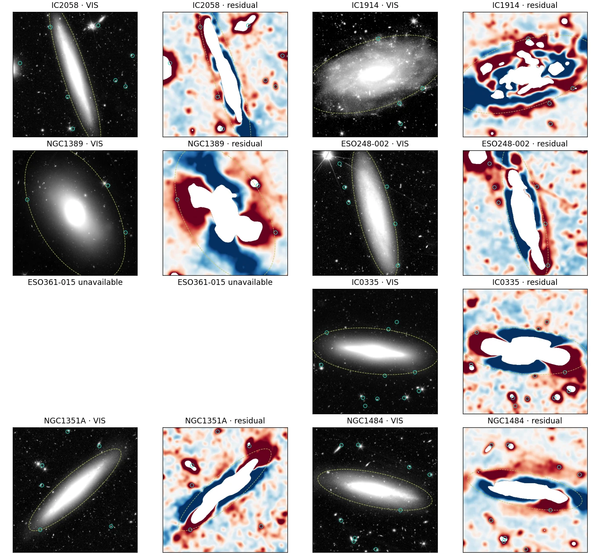
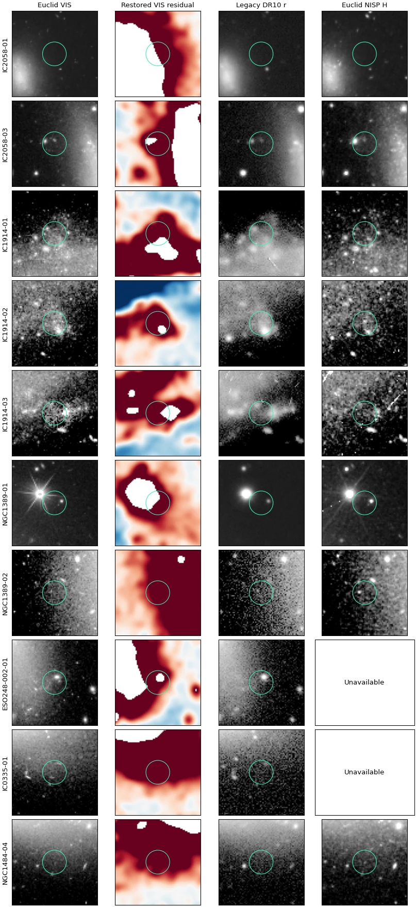

# A search for diffuse structures around nearby galaxies in Euclid DR1-Foundation

Biswajit Jana · 16 November 2026 · Exploratory research note

## Abstract

I searched Euclid VIS images for extended light in the outskirts of eight nearby galaxies selected from the Spitzer Survey of Stellar Structure in Galaxies before image inspection. Seven had usable VIS coverage in the adopted MER cutouts. A two-scale residual search flagged 47 patches, of which ten met an exploratory elongation cut. Four of those ten also had positive 5″-radius aperture residuals above at least 90% of usable comparison positions in background-restored VIS, Legacy Surveys DR10 DECam r, and Euclid NISP H. Image inspection associates the four with projected galaxy outskirts, with compact-source blending in one case. Two asymmetries around IC 1914 are particularly clear across instruments, although the images leave their origin unresolved. This pilot establishes no previously unseen object or tidal stream.

## Targets and images

From 2,352 S4G catalogue entries, 142 galaxy centres intersected the DR1-Foundation Wide Survey MER catalogue footprint. Eighteen passed cuts of 60–120″ in 3.6 μm semimajor axis at 25.5 mag arcsec⁻², minor-to-major ratio at most 0.60, and a positive catalogue distance of at most 25 Mpc. I used the eight largest semimajor axes, breaking the size tie by descending object name. I fixed the sample before opening the Euclid cutouts and kept all eight entries. The closest position in the local Wide MER catalogue slice supplied each target's tile ID. ESO 361-015 has an all-zero VIS cutout for that tile despite its centre falling in the catalogue footprint. The other seven have more than 99.9% finite, nonzero block values in the search geometry within each stamp. No claim is made about overlapping tiles for ESO 361-015.

IRSA supplied the official DR1-Foundation MER background-subtracted VIS and H mosaics and the corresponding VIS background model. I also obtained Legacy Surveys DR10 r images centred on each of the eight targets. These are older DECam observations. The radial residuals, regions, elongations, and aperture ranks below are measurements from this study. Euclid's pipeline supplies the mosaics and background models. [Target list](data/targets.csv) · [Tile lookup](data/tile_lookup.json) · [Recorded image products](#reproduction)



*The left image in each pair is Euclid VIS. The right image is the 3″ Gaussian-smoothed residual divided by the field's robust scatter at that scale. The dashed line marks the inflated Spitzer ellipse. Circles mark local peaks of the flagged regions. Each panel spans 216″. North is up and east is left. White in the residual panels indicates insufficient valid weight after clipping or missing data.*

## Search and checks

1. Form nominally 240″ × 240″ VIS cutouts and take the median of valid pixels in each 5 × 5 block, giving 0.5″ sampling. Derive sky offsets using the image WCS. Subtract a median profile in 2″ bins of elliptical radius at fixed S4G position angle and axis ratio.
2. Search projected radii of 40–105″ outside 1.15 times the S4G isophotal ellipse. Clip residual pixels above six robust scatter units in absolute value when forming the smoothed maps. Smooth at Gaussian scales of 1.5″ and 3″. Flag eight-connected positive patches covering at least 20 arcsec² that exceed two and three field scatter units on the fine and coarse maps, respectively. The scatter is the normalised median absolute deviation at the respective scale. The thresholds rank residual structure under spatially correlated noise.
3. Use the peak of the coarse map as the fixed follow-up coordinate. Measure a clipped mean residual in a 5″-radius aperture at that position in four images, including VIS with the archived MER background model added back pixelwise. Place control apertures at the same elliptical radius, testing angles in 5° increments and retaining nonoverlapping apertures with centres in the search range. Require at least 65% usable area per aperture. The rank is the fraction of retained controls strictly fainter than the candidate. It is a local descriptive measure.
4. After the first screen I prioritised elongated regions with a ratio of major-to-minor RMS extent of at least 2 and major-axis RMS extent of at least 4″. For the cross-image comparison I required positive residuals, at least ten controls, and rank fractions of at least 0.90 in restored VIS, DECam r and NISP H. These were exploratory checks. The comparison looks for positional agreement in the aperture rather than testing whether the full shape recurs across bands.

| Galaxy | VIS patches | Elongated patches | Elongated patches meeting the cross-image rule |
|---|---:|---:|---:|
| IC 2058 | 8 | 2 | 1 |
| IC 1914 | 4 | 3 | 2 |
| NGC 1389 | 3 | 2 | 0 |
| ESO 248-002 | 6 | 1 | H cutout unavailable |
| ESO 361-015 | VIS unavailable | — | — |
| IC 335 | 11 | 1 | H cutout unavailable |
| NGC 1351A | 6 | 0 | 0 |
| NGC 1484 | 9 | 1 | 1 |
| **Total** | **47** | **10** | **4** |

## The four positions that repeated across images

| VIS patch | ICRS RA (deg) | ICRS Dec (deg) | Restored VIS rank | Legacy r rank | NISP H rank | Image interpretation |
|---|---:|---:|---:|---:|---:|---|
| IC2058-03 | 64.497300 | −55.910303 | 20/20 | 20/20 | 20/20 | Compact source at the disc edge |
| IC1914-01 | 49.852740 | −49.582546 | 31/31 | 31/31 | 30/31 | Knotty extension at the projected edge of the disc |
| IC1914-03 | 49.819674 | −49.606381 | 28/30 | 29/30 | 28/30 | Narrow extension apparently continuous with the outer light |
| NGC1484-04 | 58.558704 | −36.980743 | 23/23 | 22/23 | 22/23 | Broad galaxy light gradient at the selected position |



*Each zoom spans 36″ and the circle marks the 5″-radius aperture. The grayscale panels use separate local stretches. The restored VIS residual uses a fixed scale of ±1.5 native residual scatter units after 1.5″ Gaussian smoothing. White gaps in this column mark insufficient weight after clipping. For two targets the H archive did not return the image.*

## What remains open

IC 1914 is the strongest case to carry forward. Its two positions above lie about 62″ and 86″ from the centre in projection. They remain visible in older DECam data and are more plausibly related to the projected disc than detached streams on the present evidence. A fixed-ellipse model can leave ordinary spiral arms and variations in disc shape as positive patches. The telescope's angular resolution helps trace compact optical structure and distinguish it from diffuse light. A variable-shape disc model and a spatially registered 21 cm velocity map would test whether the structures follow the disc. Published ATCA observations for HIPASS J0319−49 include integrated intensity and velocity maps. Their fitted H I geometry (axis ratio 0.55, position angle −68.4°) puts the two VIS positions at elliptical radii of 104″ and 118″. On the same approximate distance scale used by Reeves et al. (853 km s⁻¹ divided by 71 km s⁻¹ Mpc⁻¹), these correspond to 6.1 and 6.9 kpc, within the published azimuthally averaged H I radius of 12.2 kpc. The published H I maps have a beam of about 60″, much broader than the 10″ optical apertures. The comparison places the features within the approximate gas-disc extent without resolving their local gas velocities or establishing stellar membership. [SIMBAD identifiers](https://simbad.cds.unistra.fr/simbad/sim-id?Ident=IC1914) · [Reeves et al. 2016](https://doi.org/10.1093/mnras/stv3011)

The literature check covered the Euclid DR1-Foundation publication list, the release documentation, arXiv searches on stream surveys and object names, and published cross-archive studies. The direct ADS object query returned no usable page during this run. The Dorado ERO analysis already examined IC 2058 and reported no tidal features associated with that disc. A pre-Euclid S4G study reports an extension around NGC 1484 and a warp in NGC 1351A. These host-level findings do not identify the individual residuals measured here. STRRINGS supplies a wider comparison survey of tidal features, but this pilot did not complete a coordinate match to a machine-readable STRRINGS table. [Urbano et al. 2025](https://doi.org/10.1051/0004-6361/202453534) · [Kim et al. 2014](https://doi.org/10.1093/mnras/stu1642) · [Sola et al. 2025](https://doi.org/10.1093/mnras/staf1647)

The aperture ranks can be high in several bands because real host structure, compact sources and foreground emission persist across images. They cannot be multiplied to estimate false alarm rates. Adding back the MER model reverses the final MER background subtraction only. Earlier processing can still attenuate diffuse emission. There are no injection–recovery limits for this search, so it cannot exclude faint tidal debris or estimate its frequency. An independent, tidal-feature-optimised optical stack and injection tests on real backgrounds would be needed to establish sensitivity on stream widths and lengths. [ESA explanatory supplement](https://euclid.esac.esa.int/dr/dr1/expsup/) · [Euclid Consortium release papers](https://euclid-ec.net/dr1-f-publication/) · [Euclid Q1 background-restoration example](https://doi.org/10.1051/0004-6361/202554547) · [Bamford et al.](https://arxiv.org/abs/2610.29682)

## Reproduction

From this directory with Python 3.12 or compatible Python installed:

```bash
python -m pip install numpy scipy astropy matplotlib mocpy
python analysis/setup_targets.py selection-cache
python analysis/fetch.py data/targets.csv image-cache --bands vis vis_sky h
python analysis/fetch_legacy.py data/targets.csv image-cache
python analysis/quicklook.py data/targets.csv image-cache replay
python analysis/validate.py data/targets.csv image-cache replay --elongated
```

The first command after package installation regenerates target selection independently of the tile lookup. The next two request the images. Retry any transient HTTP errors to recover the same cutouts. The measured run had HTTP 503 errors on the H requests for ESO 248-002 and IC 335, so those entries are missing in its aperture file. A replay where those requests succeed can add H measurements to the two fields. The image manifests record the original public keys, crop bounds as zero-based half-open pixel intervals and SHA-256 hashes of the cutout pixels or Legacy FITS files. The replay commands write figures as PNGs. The figures above are WebP conversions.

[VIS manifest](data/cutouts_vis.json) · [VIS background model manifest](data/cutouts_vis_sky.json) · [NISP H manifest](data/cutouts_h.json) · [Legacy r manifest](data/cutouts_legacy_r.json) · [All 47 VIS patches](data/vis_candidates.json) · [Aperture measurements](data/aperture_checks.json) · [Search protocol](protocol.md)

This work used Euclid DR1-Foundation public data from the ESA Euclid mission, provided by NASA/IPAC IRSA, and public images from the DESI Legacy Imaging Surveys. The parent catalogue is the NASA/IPAC release of the Spitzer Survey of Stellar Structure in Galaxies. [IRSA Euclid DR1](https://irsa.ipac.caltech.edu/data/Euclid/docs/overview_dr1.html) · [Legacy Surveys DR10 documentation](https://www.legacysurvey.org/dr10/description/) · [S4G catalogue](https://doi.org/10.26131/IRSA425)
