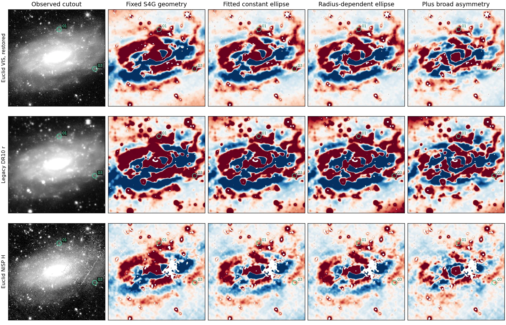

# Do the outer-disc features of IC 1914 survive a different disc model?

Biswajit Jana · 16 November 2026

Both excesses from the [nearby-galaxy search](../) survive when the disc's axis ratio and position angle can change with radius. At the same two positions, the background-restored Euclid VIS apertures retain 93% and 96% of their excesses relative to a fixed Spitzer geometry. Both positions also remain bright after a model of broad azimuthal asymmetry is added. The residuals are embedded in larger patterns of disc light. The evidence supports two persistent local asymmetries without establishing a distinct tidal feature.

## Observations and test

I used 330″ Euclid VIS and NISP H cutouts from DR1-Foundation tile 102020046 and a matching Legacy DR10 DECam r cutout. I restored the final MER background model to VIS and kept the standard MER H image. Profile fitting uses 0.50″ blocks in Euclid and a 0.65″ grid from the Legacy cutout service. These are the same observations used in the pilot, with wider cutouts on each band. S4G supplies the centre, starting position angle of −72.2° east of north, and starting minor-to-major axis ratio of 0.453. Image products and checksums are in the [input manifest](inputs.json). [Euclid documentation](https://euclid.esac.esa.int/dr/dr1/expsup/) · [Legacy Surveys DR10](https://www.legacysurvey.org/dr10/description/) · [S4G catalogue](https://doi.org/10.26131/IRSA425)

I fitted three concentric-ellipse models independently in each image. The first holds the S4G geometry fixed. The second fits one axis ratio and position angle. The third allows both parameters to vary as a smooth hyperbolic-tangent transition centred at a semimajor axis of 90″ with a 48″ scale. Each model interpolates a piecewise linear radial profile. Fits use a soft-L1 loss, a weak penalty on profile curvature, and pixels initially between 12″ and 210″ in S4G elliptical radius. I masked compact high-pass outliers and withheld all pixels within 12″ of either candidate. I repeated the fits with an 18″ exclusion. This implementation fits the pixel data directly using nested ellipses. Classical galaxy-isophote fitting provides the methodological precedent. [Search protocol](protocol.md) · [Jedrzejewski 1987](https://doi.org/10.1093/mnras/226.4.747)

In the exploratory fourth model, I subtracted smooth Fourier terms of orders 1 and 2 fitted to the variable-shape model's residuals. These terms describe broad lopsided and twofold patterns with amplitudes that change slowly with radius. They leave the candidate locations out of the fit. For every model I computed the mean residual in each 5″-radius candidate aperture and subtracted the median of comparison apertures about the same S4G ellipse. The controls are nonoverlapping and use identical positions and masks within each band. The rank counts how many controls are fainter. The positions came from the earlier VIS search, so these are descriptive ranks of selected positions.



*North is up and east is left. Panels span 210″. Green circles mark the original 5″-radius apertures. Red and blue show positive and negative residuals smoothed at 1.5″, with a common scale across the four residual panels within each band. White gaps mark low usable weight. The aperture statistics use unsmoothed pixels.*

## Results

The excesses below are in the native image units within each band. The controls are the same across models and exclusion radii. The table shows the 12″ exclusion results.

| Band | Position | Fixed S4G excess | Radius-dependent excess | Rank | After broad asymmetry | Rank |
|---|---|---:|---:|---:|---:|---:|
| Restored VIS | IC1914-01 | 0.003800 | 0.003526 | 30/30 | 0.004248 | 30/30 |
| Restored VIS | IC1914-03 | 0.003876 | 0.003727 | 29/29 | 0.003280 | 29/29 |
| Legacy r | IC1914-01 | 0.005524 | 0.005001 | 30/30 | 0.006077 | 30/30 |
| Legacy r | IC1914-03 | 0.004441 | 0.004178 | 29/29 | 0.004125 | 29/29 |
| NISP H | IC1914-01 | 0.6581 | 0.5609 | 28/30 | 0.8310 | 29/30 |
| NISP H | IC1914-03 | 0.4390 | 0.4104 | 27/29 | 0.3536 | 25/29 |

Increasing the exclusion from 12″ to 18″ preserves the sign and ranks of both positions with the radius-dependent and Fourier models. In restored VIS the fitted axis ratio varies from 0.501 to 0.494 between semimajor axes of 45″ and 135″, and the fitted position angle changes from −77.3° to −72.1°. The added radial freedom produces a slightly higher median holdout error than the fitted constant ellipse in all three bands. The broad azimuthal terms reduce that error relative to the radius-dependent fit in all three bands. The holdouts use four folds made from interleaved 22.5° sky sectors and measure median absolute residuals over S4G elliptical radii of 80–145″ outside the candidate exclusions.

| Band | Fixed S4G | Fitted constant | Radius-dependent | Plus broad asymmetry |
|---|---:|---:|---:|---:|
| Restored VIS | 0.001734 | 0.001666 | 0.001683 | 0.001490 |
| Legacy r | 0.001902 | 0.001541 | 0.001568 | 0.001441 |
| NISP H | 0.5366 | 0.5185 | 0.5407 | 0.5116 |

IC1914-01 lies on the northern edge of a broader residual pattern and is the stronger follow-up target. The western patch IC1914-03 still beats every optical control, but its H-band rank drops to 25/29 after the broad-asymmetry correction. Spiral arms and tidal debris can both leave local residuals at these scales. The pilot's geometric comparison places both positions within the approximate published H I extent. The ATCA H I beam is about 60″, so it provides disc-scale context for 10″-diameter optical apertures. These images alone leave the candidates' origin unresolved. [Reeves et al. 2016](https://doi.org/10.1093/mnras/stv3011)

## Reproduction

From this directory with Python 3.12 and NumPy, SciPy, Astropy and Matplotlib installed:

```bash
python fetch_inputs.py image-cache
OPENBLAS_NUM_THREADS=1 python fit_disc.py image-cache replay
```

The first command verifies downloaded image checksums and bounds. The second writes a PNG of the figure and the JSON data. The [recorded measurements](measurements.json) include the original coordinates, model parameters, per-aperture control values, and individual angular holdout results. This work used public ESA Euclid DR1-Foundation data from NASA/IPAC IRSA and public DESI Legacy Imaging Surveys DR10 images.
