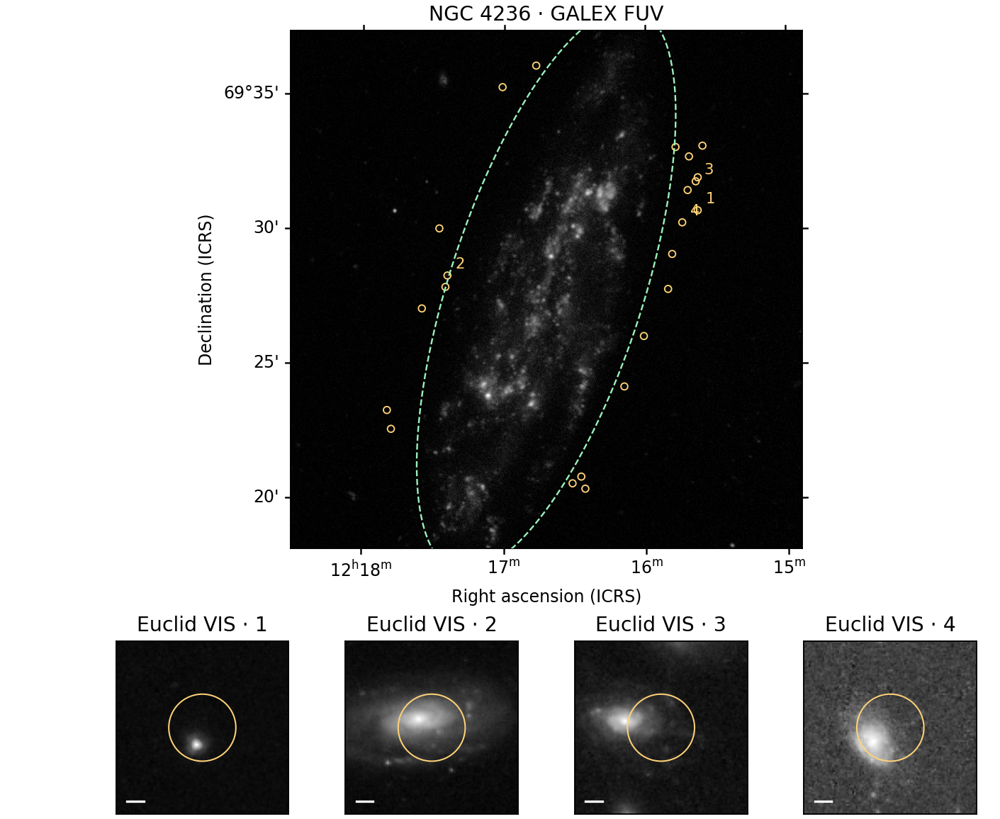
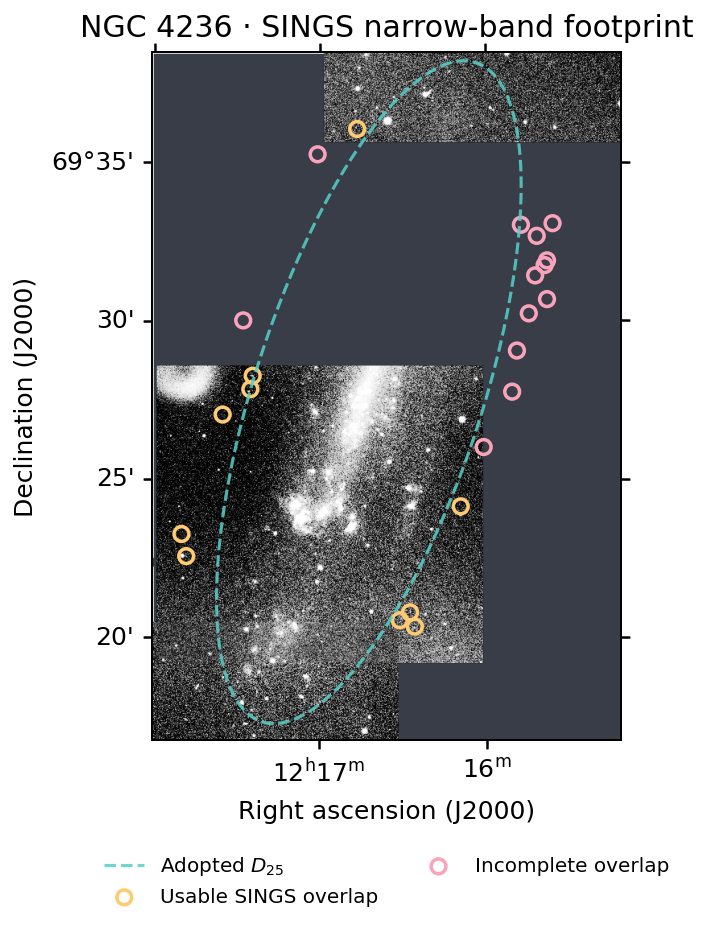

# Ultraviolet knots and optical counterparts in NGC 4236

Biswajit Jana · Exploratory study · 16 November 2026

[Research note (PDF)](report/NGC4236_UV_VIS.pdf) · [LaTeX source](report/NGC4236_UV_VIS.tex)

## Abstract

We tested whether ultraviolet peaks near the projected outskirts of the inclined galaxy NGC 4236 coincide with compact optical structure. Of 182 GALEX peaks in strips offset from the midplane, 143 have a stronger Euclid DR1-Foundation VIS peak than the median at nearby control positions, and two lie outside the adopted optical isophote. A separate scan restricted to its exterior yields 23 UV peaks, of which 20 exceed every local VIS control. A Gaia DR3 comparison identifies the optical peak of one of those 23 UV candidates with a foreground star. Archival SINGS narrow-band and R-band imaging covers 10 of the 23 candidates under a common footprint criterion. The study establishes a projected UV–optical association and gives one direct example of foreground contamination. It leaves the origin of the other exterior counterparts and their relation to the extraplanar ionised gas unresolved.

## Observations and methods

Chyży et al. (2007) reported Hα emission away from the plane in NGC 4236. Young stars at those locations could ionise gas locally. Gas can also be ionised by photons originating in the disk. We use GALEX FUV and NUV continuum images from the Local Volume Legacy survey and the background-subtracted MER VIS mosaic and flag image of Euclid tile 102161072. The comparison is based on measurements made on the archived images.

The initial search covers ±480″ along the major axis at PA 162°, and offsets of 60–180″ on either side of the projected midplane. At the adopted distance of 4.45 Mpc the latter offsets are 1.29–3.88 kpc in projection. We restrict the search to FUV exposure greater than 500 s. The detection map is the difference between the ultraviolet image smoothed with Gaussians of 1.8″ and 12″ standard deviation. A local maximum must exceed five robust background scatter estimates in FUV and three in NUV within 3″. These ratios screen candidates in the presence of structured backgrounds.

In Euclid VIS we measure the strongest smoothed pixel inside 2″ of each UV peak, relative to the median and robust scatter of its 3–5″ background annulus. In the VIS mosaic only pixels with finite science values and the lowest flag bit clear are counted as usable. Each position needs at least 90% usable VIS pixels inside 5″. We repeat the measurement at shifts of ±15″, ±30″ and ±45″ along the major axis. We exclude controls within 8″ of a selected UV peak and require at least three usable controls per candidate. The exploratory exterior search uses a 21.9′ × 7.2′ optical ellipse and confines both candidates and controls to its exterior within |major| ≤ 480″ and |minor| ≤ 270″.

For the exterior sample we compare the VIS maxima and GALEX positions with a Gaia DR3 query via the ARI mirror. We propagate Gaia positions from J2016.0 to the GALEX observation date of 24 January 2004 and to a representative Euclid epoch of J2025.0. A foreground flag requires the same Gaia source within 0.7″ of the VIS peak and 3″ of the GALEX peak, RUWE below 1.4 and a positive parallax or absolute single-component proper motion at least five times its formal uncertainty. Missing astrometry provides no classification. For SINGS we require at least 90% finite, non-zero pixels inside 6″ of the UV coordinate in each of the narrow-band and R mosaics. Contiguous zero padding is treated as missing coverage.

## Results

| Selection | Peaks passing both UV cuts | VIS plus ≥3 controls | Above control median | Above every control |
|---|---:|---:|---:|---:|
| Projected 60–180″ strips | 190 | 182 | 143 | 80 |
| Exterior to the adopted optical ellipse | 23 | 23 | 23 | 20 |

The strip sample and exterior scan share two measured peaks. At fixed centre and PA, increasing both adopted ellipse axes by 10% moves both strip peaks inside and reduces the exterior sample beyond the boundary to 17 of the original 23. Only two exterior candidates have their strongest VIS peak within 1″ of the UV position. The VIS controls can share background structure and the counts are descriptive.



*Gold markers are the exterior GALEX candidates. The lower panels are Euclid VIS cutouts of the four brightest candidates by filtered FUV score. Each circle has a 2″ radius and each white bar spans 1″.*

Gaia supplies three close matches (candidates 1, 6 and 23). For candidate 23, Gaia DR3 1683447512960230528 lies 0.048″ from the VIS peak and 1.93″ from the GALEX peak at their adopted epochs. Its right-ascension and declination proper-motion components are 9.7 and 54.9 times their formal uncertainties in absolute value. The same three associations survive VIS radii of 0.5–1.0″. Candidate 1, the brightest UV peak by the adopted statistic, has a Gaia counterpart but neither significant parallax nor significant proper motion. Candidate 6 lacks a motion solution. The foreground identification applies to the VIS peak of candidate 23. A larger GALEX beam leaves open whether all its UV flux comes from that star.



*Gold rings show the 10 candidates with usable narrow-band and R overlap. Pink rings show the 13 with incomplete overlap. Grey areas inside the panel are padded regions of the narrow-band mosaic.*

Twelve candidates have zero usable narrow-band pixels inside the 6″ radius and one has partial overlap. The archival file is a narrow-band exposure with stellar continuum and possible [N II] contributions. The inspection measured its footprint only. The Hα clumps mapped by Chyży et al. were observed with a different instrument and have no candidate-by-candidate association in this study.

## Interpretation

Euclid resolves optical sources within some GALEX beams, including a foreground star. A UV–VIS match can therefore occur through a source unrelated to NGC 4236. At the galaxy's inclination a minor-axis offset and an isophotal boundary also leave the physical height of a source ambiguous. This pilot leaves the membership of the remaining candidates open and does not constrain the abundance of extraplanar young stars. The footprint and candidate positions identify where a deeper continuum-subtracted image or a velocity measurement would be needed to test the connection to the known ionised gas.

## Reproduce

Use Python 3.12 with NumPy, SciPy, Astropy and Matplotlib. The FITS files total 3.29 GB. The original pilot and follow-up measurements use the following commands from the study directory.

```bash
python analysis/fetch_inputs.py /path/to/cache
python analysis/measure.py --data /path/to/cache --output /path/to/strips
python analysis/measure.py --data /path/to/cache --output /path/to/exterior --outer
python analysis/validate_exterior.py --data /path/to/cache --output /path/to/validation
```

The validation reads the checked-in pilot CSVs, checks the exterior VIS scores against the FITS measurements and uses the saved 479-row Gaia query from the [ARI TAP mirror](https://gaia-backend.ari.uni-heidelberg.de/tap.html). The [Gaia query](analysis/gaia_dr3_field.adql) uses `gaiadr3.gaia_source_lite`. The [FITS manifest](analysis/inputs.json) records URLs, sizes and SHA-256 checksums.

[Initial protocol](analysis/protocol.md) · [Strip measurements](analysis/knots.csv) · [Exterior measurements](analysis/outer_knots.csv) · [Gaia and SINGS checks](analysis/exterior_validation.csv) · [Summary counts](analysis/exterior_validation.json)

## References

- Chyży et al. (2007), A&A, 462, 933. [10.1051/0004-6361:20065932](https://doi.org/10.1051/0004-6361:20065932)
- Gil de Paz et al. (2007), ApJS, 173, 185. [10.1086/516636](https://doi.org/10.1086/516636)
- Dale et al. (2009), ApJ, 703, 517. [10.1088/0004-637X/703/1/517](https://doi.org/10.1088/0004-637X/703/1/517)
- Lee et al. (2011), ApJS, 192, 6. [10.1088/0067-0049/192/1/6](https://doi.org/10.1088/0067-0049/192/1/6)
- Euclid Consortium and ESA (2026). [DR1-Foundation Explanatory Supplement](https://euclid.esac.esa.int/dr/dr1/expsup/)
- NASA/IPAC IRSA. [SINGS NGC 4236 data](https://irsa.ipac.caltech.edu/data/SPITZER/SINGS/galaxies/ngc4236.html) · [SINGS DOI](https://doi.org/10.26131/IRSA424) · [LVL DOI](https://doi.org/10.26131/IRSA414)
